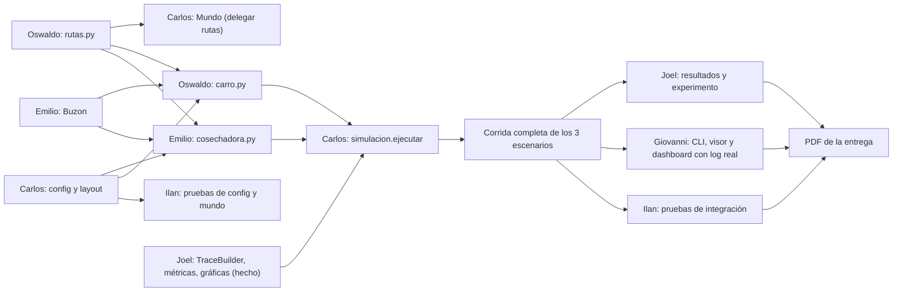

# Plan de trabajo — Entrega del martes 17 de noviembre (antes de la clase)

Reparto, dependencias, cronograma y flujo de git. **El detalle de cada persona está en su guía, en [`docs/equipo/`](equipo/README.md)**: qué archivos escribe, qué debe hacer cada función, qué pruebas deben pasar y cuándo está listo. La [especificación](especificacion_primera_entrega.md) dice **qué** se construye; este plan dice **quién**, **en qué orden** y **cómo se junta**.

> **Integrado el 17 de noviembre:** las seis partes están en `development` y `main`; los tres escenarios corren completos y las 230 pruebas pasan. Solo falta el PDF (Joel).
>
> **Actualizado el 16 de noviembre.** La entrega se movió al martes 17 antes de la clase, con la rúbrica nueva del anuncio de Canvas (PDF en `reto/`). La parte de Datos está terminada; el resto del código está por hacer. El formato del log es el **trace 2.1** y el contrato está en [`docs/equipo/README.md`](equipo/README.md) §3.

---

## 1. Resumen en una pantalla

| Persona | Rama | Archivos que le pertenecen | Estado | Guía |
|---|---|---|---|---|
| **Carlos** (Mundo) | `branch-carlos` | `config.py`, `mundo.py`, `simulacion.py`, `config/escenario_*.json` | Hecho e integrado | [carlos/guia.md](equipo/carlos/guia.md) |
| **Oswaldo** (Rutas y carro) | `branch-oswaldo-rutas` | `rutas.py`, `carro.py`, `tests/test_rutas.py`, `tests/test_carro.py` | Hecho e integrado | [oswaldo/guia.md](equipo/oswaldo/guia.md) |
| **Emilio** (Mensajes y cosechadora) | `branch-emilio` | `mensajes.py`, `cosechadora.py`, `tests/test_mensajes.py`, `tests/test_cosechadora.py` | Hecho e integrado | [emilio/guia.md](equipo/emilio/guia.md) |
| **Joel** (Datos) | `branch-joel` | `src/harvest_sim/datos/`, `telemetria.py` (fachada), `viz/plots.py`, `tools/`, `config/experimentos/`, `tests/fixtures/` y las pruebas de Datos | **Hecho**, salvo las corridas reales | [joel/estado.md](equipo/joel/estado.md) |
| **Mario Giovanni** (Interfaz) | `mario_branch` | `viz/viewer.py`, `viz/dashboard.py`, `cli.py`, `tests/test_viewer.py`, `tests/test_dashboard.py` | Hecho e integrado | [giovanni/guia.md](equipo/giovanni/guia.md) |
| **Ilan** (Calidad) | `branch-ilan` | `tests/test_mundo.py`, `tests/test_config.py`, `tests/test_integracion.py`, `.github/`, `scripts/`, `README.md`, `docs/autoevaluacion.md` | Hecho e integrado | [ilan/guia.md](equipo/ilan/guia.md) |

**Regla de oro:** cada archivo tiene un solo dueño. Si necesitas un cambio en un archivo ajeno, se lo pides al dueño; no lo editas tú.

---

## 2. Qué cambió respecto al plan anterior

- **Fecha:** martes 17 antes de la clase (antes, lunes 16). Se entrega un **PDF** con la rúbrica nueva: dashboard obligatorio, 3 escenarios justificados, barrido de parámetros, comparación contra método base y análisis crítico ([README del equipo](equipo/README.md) §5).
- **Formato del log: trace 2.1** (decisiones del 2026-11-15 y 2026-11-16). Cambia lo que cada quien entrega:
  - `Mundo.cambios()` y `mundo.tick_actual` **ya no se usan**: el mundo junta sus eventos y los entrega con `drenar_eventos()`; se agrega `registrar_bloqueo(agent_id)`.
  - `Buzon.registro()` **ya no se usa**: el buzón entrega `drenar_eventos()` con `MENSAJE_ENVIADO` (con `performativa`) y `MENSAJE_ENTREGADO`.
  - `registro()` de los agentes **sin** `intencion` ni `objetivo`; el vocabulario de `intencion.accion` del plan anterior desaparece.
  - `mundo.descripcion()` trae `obstaculos`.
- **Configuración:** sección `obstaculos` (vacía) y una sola fórmula del grano esperado en `harvest_sim.datos.campo` ([README del equipo](equipo/README.md) §4).
- **Datos:** `telemetria.py` pasó a ser el paquete `harvest_sim/datos/` (los imports viejos siguen funcionando); métricas para cualquier número de agentes; 6 gráficas por corrida; ejecutor de experimentos.
- **Nuevo para Giovanni:** el dashboard (`viz/dashboard.py`).

---

## 3. Contrato de interfaces

Está en [`docs/equipo/README.md`](equipo/README.md) §3 (trace 2.1 y lo que entrega cada módulo) y en la especificación §10. Las firmas de cada función están en los docstrings de cada archivo del esqueleto y en la guía de su dueño.

---

## 4. Tareas por persona

Cada guía trae las tareas en orden, con tiempo estimado, firma de cada función, ejemplo, pruebas que deben pasar y definición de listo. Resumen:

| Persona | Tareas (en orden) | Medible: listo cuando |
|---|---|---|
| Carlos | Config con obstáculos → layout del mundo ⚡ → grano y eventos → catálogo → `simulacion.ejecutar` → escenarios → PDF §1–2 | `test_config.py`, `test_mundo.py` y `test_integracion.py` pasan; el validador da `OK` en los 3 traces |
| Oswaldo | `rutas.py` ⚡ → dobles de prueba → `carro.py` → `registro()` → dobles por reales → PDF §2 | `test_rutas.py` (9) y `test_carro.py` (6) pasan sin `skip` |
| Emilio | `Buzon` ⚡ → dobles → `cosechadora.py` → `registro()` → dobles por reales → PDF §1 | `test_mensajes.py` (5) y `test_cosechadora.py` (8) pasan sin `skip` |
| Giovanni | Visor → CLI → dashboard → PDF §6 | `test_viewer.py` y `test_dashboard.py` pasan; `python -m harvest_sim.cli config/escenario_a.json` genera trace y gráficas; el dashboard muestra 3 paneles |
| Ilan | CI → pruebas de config y mundo → integración → scripts → README → autoevaluación → PDF §3 y §8 | CI verde; sin `skip` en sus pruebas; `verificar_instalacion.sh` pasa en limpio |
| Joel | Corridas reales, gráficas, experimento y tabla → PDF §4, §5 y §7 → armar y subir el PDF final | Resultados de los 3 escenarios y del barrido en `runs/` |

⚡ = destraba a otra persona: hazlo primero y súbelo en cuanto pase.

---

## 5. Dependencias



| Quién puede empezar ya | Con qué | Por qué no espera |
|---|---|---|
| Oswaldo | `rutas.py` | Funciones puras |
| Emilio | `Buzon` | No depende de nada |
| Carlos | Configuración y layout | Solo usa la especificación |
| Giovanni | Visor y dashboard | Hay traces de ejemplo (`tools/generar_trace_ejemplo.py --escenarios`) |
| Ilan | CI y pruebas | Salen de la especificación |

| Tarea que espera | Espera a | Mientras tanto |
|---|---|---|
| `carro.py` y `cosechadora.py` completos | `Buzon`, layout y `rutas.py` | Dobles de prueba en sus tests |
| `simulacion.ejecutar` | Agentes y buzón | Agentes falsos que terminen rápido |
| CLI | `ejecutar` | `ejecutar` falso que devuelva el fixture |
| Resultados reales | Corrida completa | Todo probado con datos de ejemplo |

---

## 6. Cronograma

| Momento | Hito | Quién |
|---|---|---|
| **Lunes tarde** | `rutas.py`, `Buzon`, configuración y layout del mundo en `development`; CI verde; visor leyendo los traces de ejemplo | Oswaldo, Emilio, Carlos, Ilan, Giovanni |
| **Lunes noche** | Agentes con sus pruebas pasando (dobles); grano y eventos del mundo; pruebas de mundo activadas | Oswaldo, Emilio, Carlos, Ilan |
| **Lunes, antes de dormir** | **Hito 1:** `simulacion.ejecutar` corre los 3 escenarios (aunque sea feo) y el validador da `OK` | Carlos, con Emilio y Oswaldo |
| **Martes temprano** | Corridas reales, gráficas, experimento y tabla; CLI; visor y dashboard con el log real; pruebas de integración sin `skip` | Joel, Giovanni, Ilan |
| **Martes, mediodía** | Cada quien le manda a Joel su sección del PDF; **congelamiento del código** (solo correcciones) | Todos |
| **Martes, antes de la clase** | PDF armado y subido a Canvas; `development` → `main` con etiqueta `v0.1-entrega1` | Joel (PDF), Ilan y Joel (merge) |

### Qué se recorta si el tiempo aprieta (en este orden)

1. Funciones extra del visor (estela, velocidad); queda el reproductor básico.
2. Animación del panel del entorno del dashboard; quedan cuadros fijos.
3. El experimento de barrido (queda la comparación entre los 3 escenarios).

**No se recorta:** simulación completa de los 3 escenarios, reglas físicas con pruebas, trace válido, métricas y gráficas, dashboard (obligatorio) y README que funcione.

---

## 7. Flujo de git

### 7.1 Ramas

| Rama | Para qué | Quién escribe |
|---|---|---|
| `main` | Lo que se entrega. Solo se toca el martes antes de la clase | Se actualiza por PR desde `development` |
| `development` | Integración: aquí se junta el trabajo de todos | Solo por PR desde las ramas personales |
| `branch-carlos`, `branch-oswaldo`, `branch-emilio`, `branch-joel`, `branch-giovanni`, `branch-ilan` | Una por persona | Su dueño |

### 7.2 Diagrama de versiones (ejemplo de cómo se ve la integración)

```mermaid
gitGraph
   commit id: "Esqueleto"
   branch development
   checkout development
   commit id: "Ajustes del esqueleto"
   checkout development
   branch branch-joel
   checkout development
   branch branch-carlos
   checkout development
   branch branch-oswaldo
   checkout development
   branch branch-emilio
   checkout development
   branch branch-giovanni
   checkout development
   branch branch-ilan
   checkout branch-ilan
   commit id: "CI"
   checkout development
   merge branch-ilan id: "PR: CI"
   checkout branch-joel
   commit id: "Fixture de ejemplo"
   checkout development
   merge branch-joel id: "PR: fixture"
   checkout branch-oswaldo
   commit id: "vecinos y bfs"
   checkout development
   merge branch-oswaldo id: "PR: rutas basicas"
   checkout branch-emilio
   commit id: "Buzon FIFO con ids"
   checkout development
   merge branch-emilio id: "PR: buzon"
   checkout branch-carlos
   commit id: "Layout y serpentina"
   checkout development
   merge branch-carlos id: "PR: mundo base"
   checkout branch-emilio
   merge development id: "Emilio trae lo nuevo"
   commit id: "cosechadora"
   checkout branch-oswaldo
   merge development id: "Oswaldo trae lo nuevo"
   commit id: "carro"
   checkout development
   merge branch-emilio id: "PR: cosechadora"
   merge branch-oswaldo id: "PR: carro"
   checkout branch-carlos
   merge development id: "Carlos trae agentes"
   commit id: "simulacion.ejecutar"
   checkout development
   merge branch-carlos id: "PR: simulacion"
   checkout branch-joel
   merge development id: "Joel trae simulacion"
   commit id: "metricas y plots"
   checkout branch-giovanni
   merge development id: "Giovanni trae simulacion"
   commit id: "visor y CLI"
   checkout development
   merge branch-joel id: "PR: metricas"
   merge branch-giovanni id: "PR: visor y CLI"
   checkout main
   merge development tag: "v0.1-entrega1"
```

La idea que muestra el diagrama:

- El trabajo fluye siempre **rama personal → `development`** por pull request, y **`development` → rama personal** cuando necesitas lo de los demás.
- `main` se actualiza una sola vez, el martes, con todo ya integrado y probado.
- Nadie hace push directo a `development` ni a `main`.

### 7.3 Rutina de cada sesión de trabajo

```bash
git switch branch-TU-NOMBRE
git fetch origin
git merge origin/development        # traer lo que los demás ya integraron
# ... trabajar en tus archivos, hacer commits pequeños ...
pytest                              # antes de subir
git push origin branch-TU-NOMBRE
# en GitHub: abrir Pull Request  branch-TU-NOMBRE  →  development
```

- **Commits pequeños y frecuentes** con el formato `[módulo] verbo: qué`, por ejemplo `[mundo] agrega serpentina` o `[buzon] asigna ids crecientes`.
- **Un PR por hito**, no uno gigante el domingo. Cada hito de la tabla del §6 es un PR.
- **Antes de abrir el PR:** traes `development` a tu rama, corres `pytest` y verificas que los tests de tu módulo pasan.

### 7.4 Reglas

1. **Solo tus archivos** (§1). Excepciones: `docs/decisiones.md` (agregas al final; si hay conflicto, conservas las dos versiones) y `requirements.txt` (avisa antes de tocarlo).
2. **Revisión obligatoria:** cada PR necesita una aprobación antes del merge. El revisor principal es quien **consume** tu código, así detecta problemas de interfaz pronto:

   | PR de | Lo revisa |
   |---|---|
   | Carlos | Emilio |
   | Oswaldo | Carlos |
   | Emilio | Oswaldo |
   | Joel | Giovanni |
   | Giovanni | Joel |
   | Ilan | Joel |

   En los PR grandes (agentes, simulación) Ilan hace además una pasada de conformidad con la especificación.
3. **CI en verde** antes de hacer merge. Si CI falla por un test que no es tuyo, avisa a su dueño.
4. **Merge con "Merge commit"** (no squash), para que el historial del diagrama se conserve.
5. **Si dependes de algo que aún no llega a `development`:** no copies el archivo de otra persona ni hagas merge de su rama; usa un doble de prueba dentro de tus tests (§5) y cambia al real cuando llegue.
6. **Si cambias una interfaz del contrato (`docs/equipo/README.md` §3):** avisa en el chat **antes** de subir el PR y anótalo en `docs/decisiones.md`.
7. **Protección de ramas** (la configura Joel como dueño del repo, en *Settings → Branches*): exigir PR, una aprobación y CI en verde para `main` y `development`.

### 7.5 Resolver un conflicto

Como cada archivo tiene un solo dueño, los conflictos serán raros. Si ocurre uno:

```bash
git merge origin/development        # aparece el conflicto
# abre los archivos con marcas <<<<<<<, elige qué conservar, quita las marcas
git add ARCHIVO
git commit                          # termina el merge
pytest
```

Si el conflicto está en un archivo que no es tuyo, **no lo resuelvas a ciegas**: pregunta a su dueño.

---

## 8. Criterios de listo para el PR

Antes de pedir revisión, marca todo:

- [ ] Hice merge de `origin/development` en mi rama y no hay conflictos.
- [ ] `pytest` pasa y los tests de mi módulo ya no están en `skip`.
- [ ] Solo toqué archivos míos (o avisé de la excepción).
- [ ] Respeto el contrato ([`docs/equipo/README.md`](equipo/README.md) §3) y el vocabulario de `harvest_sim/datos/formato.py`.
- [ ] Si tomé una decisión no cubierta por la especificación, la anoté en `docs/decisiones.md`.
- [ ] No dejé parámetros escritos en el código; todo viene de la configuración.

---

## 9. Riesgos y plan B

| Riesgo | Señal | Qué hacer |
|---|---|---|
| Integración tardía | Lunes en la noche nada corre junto | Carlos prueba el bucle con agentes falsos; Emilio y Oswaldo priorizan que sus agentes terminen, aunque falten casos |
| Se atrasa una persona | Su PR no llega al hito | Su respaldo toma la tarea (Carlos ↔ Oswaldo, Emilio ↔ Oswaldo, Giovanni ↔ Joel, Ilan ↔ Carlos); se avisa en el chat |
| El trace no valida | `tools/validar_trace.py` da errores | El mensaje dice el tick, el evento y el campo; compara con `tests/fixtures/trace_ejemplo.json` y la guía de tu módulo |
| Interfaz que cambia a mitad | Alguien cambia una firma | Regla 6 del §7.4: avisar antes y anotar |
| No alcanza el tiempo para el PDF | Martes a mediodía sin secciones | Cada sección se escribe con lo que haya; Joel completa al armar el documento |

---

## 10. Qué se entrega el martes

1. **PDF en Canvas** con las 8 secciones de la rúbrica nueva ([README del equipo](equipo/README.md) §5).
2. Repositorio con `main` actualizado y la etiqueta `v0.1-entrega1`.
3. `python -m harvest_sim.cli config/escenario_X.json` funciona para los 3 escenarios y genera `trace.json` y gráficas.
4. `pytest` pasa completo, sin `skip` en las pruebas de reglas.
5. Visor que reproduce un log y **dashboard** con los tres paneles.
6. Resultados: tabla y gráficas de los 3 escenarios y del experimento de barrido.
7. README que funciona en un entorno limpio, y `docs/decisiones.md` al día.
