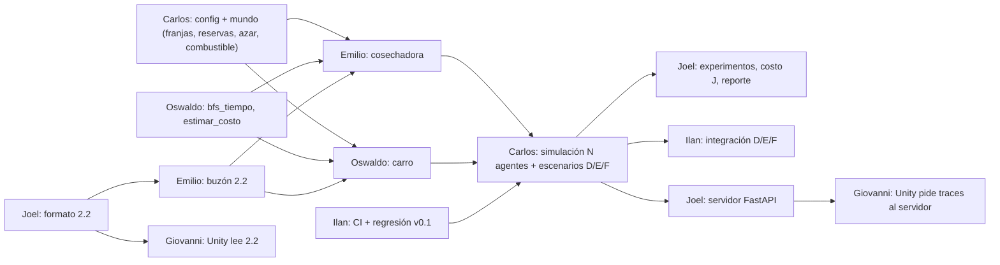

# Plan de trabajo — Segunda entrega (coordinación multiagente)

Reparto, dependencias y flujo de git. **El detalle de cada persona está en su guía, en [`docs/equipo/`](equipo/README.md).** La [especificación de la segunda entrega](especificacion_segunda_entrega.md) dice **qué** se construye; este plan dice **quién** y **en qué orden**. Las fechas las maneja el equipo. La primera entrega (`v0.1-entrega1`) está archivada en [`docs/equipo/entrega1/`](equipo/entrega1/README.md).

---

## 1. Resumen en una pantalla

| Persona | Rama | Archivos que le pertenecen | Tareas (resumen) | Guía |
|---|---|---|---|---|
| **Carlos** (Mundo) | `branch-carlos` | `config.py`, `mundo.py`, `simulacion.py`, `config/escenario_*.json` | Configuración nueva ⚡, franjas y obstáculos ⚡, reservas ⚡, azar, combustible y eventos, simulación con N agentes, escenarios D/E/F | [carlos/guia.md](equipo/carlos/guia.md) |
| **Oswaldo** (Rutas y carro) | `branch-oswaldo-rutas` | `rutas.py`, `carro.py`, sus pruebas, `docs/equipo/oswaldo/` | `bfs_tiempo` ⚡ y `estimar_costo` ⚡; carro contratista de la subasta; combustible | [oswaldo/guia.md](equipo/oswaldo/guia.md) |
| **Emilio** (Mensajes y cosechadora) | `branch-emilio` | `mensajes.py`, `cosechadora.py`, sus pruebas | Buzón con tipos nuevos y retraso ⚡; cosechadora administradora de la subasta, despacho anticipado, obstáculos, combustible | [emilio/guia.md](equipo/emilio/guia.md) |
| **Joel** (Datos) | `branch-joel` | `datos/`, `servidor.py`, `viz/plots.py`, `tools/`, `config/experimentos/`, pruebas de Datos | Formato 2.2 ⚡; métricas de combustible, restricciones, subasta y costo J; experimentos con 20 seeds; servidor FastAPI; reporte | [joel/guia.md](equipo/joel/guia.md) |
| **Mario Giovanni** (Interfaz) | `mario_branch` (y su repo de Unity) | `harvest-simu-visualization`; `viz/viewer.py`, `viz/dashboard.py`, `cli.py` y sus pruebas | Unity 2.2 con N agentes, subasta, combustible, cámara 3D y cliente del servidor; CLI, visor y dashboard | [giovanni/guia.md](equipo/giovanni/guia.md) |
| **Ilan** (Calidad) | `branch-ilan` | `test_config.py`, `test_mundo.py`, `test_integracion.py`, `test_regresion.py`, `.github/`, `scripts/`, `docs/autoevaluacion.md` | CI ⚡, regresión contra v0.1 ⚡, pruebas de los escenarios nuevos, scripts, autoevaluación con las dos rúbricas, video | [ilan/guia.md](equipo/ilan/guia.md) |

⚡ = destraba a otras personas: hazlo primero y súbelo en cuanto pase.

**Regla de oro:** con la configuración por defecto, A, B y C dan las mismas métricas que `v0.1-entrega1`. La prueba de regresión de Ilan lo vigila en cada PR.

---

## 2. Qué se agrega (resumen de la especificación)

1. **Varios agentes:** N cosechadoras (cada una en su franja del campo) y M carros.
2. **Obstáculos** que la simulación recorre y rodea.
3. **Rutas en el tiempo** (reservas): 0 colisiones y 0 bloqueos en el pasillo.
4. **Subasta Contract Net** para asignar carros (cfp, propose/refuse, accept/reject, inform).
5. **Despacho anticipado:** la cosechadora pide el carro al llegar a un umbral de carga; el carro la acompaña. Variantes: atender desde la bodega y encadenar servicios.
6. **Aleatoriedad con semilla:** rendimiento por celda, duraciones y retraso de mensajes.
7. **Combustible** dentro de la simulación, con recarga en la base y reserva de seguridad.
8. **Restricciones de seguridad registradas** (evento `RESTRICCION`, IEEE 7007).
9. **Costo J** descompuesto, con ablación (sustituye al aprendizaje por refuerzo).
10. **Servidor FastAPI** que corre simulaciones y entrega traces a **Unity** (WebGL en la entrega final).
11. **Experimentos:** escenarios D, E, F × 4 estrategias × 20 seeds, con IC 95 % y comparación contra la línea base.

---

## 3. Dependencias



| Quién puede empezar ya | Con qué |
|---|---|
| Carlos | Configuración y mundo (no usan agentes) |
| Oswaldo | `rutas.py` (funciones puras) |
| Emilio | Buzón |
| Joel | Formato 2.2, traces de ejemplo y servidor (con traces de ejemplo) |
| Mario Giovanni | Unity con los traces de ejemplo 2.2; cliente HTTP contra el servidor de prueba |
| Ilan | CI y regresión contra v0.1 |

| Tarea que espera | Espera a | Mientras tanto |
|---|---|---|
| Cosechadora y carro completos | Mundo, buzón y rutas | Dobles de prueba en sus tests |
| Simulación con N agentes | Cosechadora y carro | Agentes falsos que terminen rápido |
| Experimentos | Simulación completa | Herramienta probada con el generador de ejemplo |
| Unity con datos reales | Servidor y simulación | Traces de ejemplo 2.2 |

---

## 4. Qué se recorta si el tiempo aprieta (en este orden)

1. Interpolación y cámara en perspectiva de Unity (queda la reproducción actual con datos 2.2).
2. Escenario F (quedan D y E, los dos de conflicto que pide el curso).
3. `encadenar_servicios` (quedan `base`, `subasta` y `anticipada`).
4. Retraso aleatorio de mensajes (quedan rendimiento y duraciones).

**No se recorta:** regresión contra v0.1, varios agentes, subasta, despacho anticipado, pasillo sin colisiones, combustible funcionando, costo J, 20 repeticiones con IC y comunicación Unity–FastAPI.

---

## 5. Flujo de git

### 5.1 Ramas

| Rama | Para qué | Quién escribe |
|---|---|---|
| `main` | Lo que se entrega. Se actualiza al cerrar cada entrega | Se actualiza por PR desde `development` |
| `development` | Integración: aquí se junta el trabajo de todos | Solo por PR desde las ramas personales |
| `branch-carlos`, `branch-oswaldo`, `branch-emilio`, `branch-joel`, `branch-giovanni`, `branch-ilan` | Una por persona | Su dueño |

### 5.2 Diagrama de versiones (ejemplo de cómo se ve la integración)

```mermaid
gitGraph
   commit id: "Esqueleto"
   branch development
   checkout development
   commit id: "Ajustes del esqueleto"
   checkout development
   branch branch-joel
   checkout development
   branch branch-carlos
   checkout development
   branch branch-oswaldo
   checkout development
   branch branch-emilio
   checkout development
   branch branch-giovanni
   checkout development
   branch branch-ilan
   checkout branch-ilan
   commit id: "CI"
   checkout development
   merge branch-ilan id: "PR: CI"
   checkout branch-joel
   commit id: "Fixture de ejemplo"
   checkout development
   merge branch-joel id: "PR: fixture"
   checkout branch-oswaldo
   commit id: "vecinos y bfs"
   checkout development
   merge branch-oswaldo id: "PR: rutas basicas"
   checkout branch-emilio
   commit id: "Buzon FIFO con ids"
   checkout development
   merge branch-emilio id: "PR: buzon"
   checkout branch-carlos
   commit id: "Layout y serpentina"
   checkout development
   merge branch-carlos id: "PR: mundo base"
   checkout branch-emilio
   merge development id: "Emilio trae lo nuevo"
   commit id: "cosechadora"
   checkout branch-oswaldo
   merge development id: "Oswaldo trae lo nuevo"
   commit id: "carro"
   checkout development
   merge branch-emilio id: "PR: cosechadora"
   merge branch-oswaldo id: "PR: carro"
   checkout branch-carlos
   merge development id: "Carlos trae agentes"
   commit id: "simulacion.ejecutar"
   checkout development
   merge branch-carlos id: "PR: simulacion"
   checkout branch-joel
   merge development id: "Joel trae simulacion"
   commit id: "metricas y plots"
   checkout branch-giovanni
   merge development id: "Giovanni trae simulacion"
   commit id: "visor y CLI"
   checkout development
   merge branch-joel id: "PR: metricas"
   merge branch-giovanni id: "PR: visor y CLI"
   checkout main
   merge development tag: "v0.1-entrega1"
```

La idea que muestra el diagrama:

- El trabajo fluye siempre **rama personal → `development`** por pull request, y **`development` → rama personal** cuando necesitas lo de los demás.
- `main` se actualiza al cerrar cada entrega, con todo ya integrado y probado.
- Nadie hace push directo a `development` ni a `main`.

### 5.3 Rutina de cada sesión de trabajo

```bash
git switch branch-TU-NOMBRE
git fetch origin
git merge origin/development        # traer lo que los demás ya integraron
# ... trabajar en tus archivos, hacer commits pequeños ...
pytest                              # antes de subir
git push origin branch-TU-NOMBRE
# en GitHub: abrir Pull Request  branch-TU-NOMBRE  →  development
```

- **Commits pequeños y frecuentes** con el formato `[módulo] verbo: qué`, por ejemplo `[mundo] agrega serpentina` o `[buzon] asigna ids crecientes`.
- **Un PR por hito**, no uno gigante el domingo. Cada tarea ⚡ de tu guía es un PR.
- **Antes de abrir el PR:** traes `development` a tu rama, corres `pytest` y verificas que los tests de tu módulo pasan.

### 5.4 Reglas

1. **Solo tus archivos** (§1). Excepciones: `docs/decisiones.md` (agregas al final; si hay conflicto, conservas las dos versiones) y `requirements.txt` (avisa antes de tocarlo).
2. **Revisión obligatoria:** cada PR necesita una aprobación antes del merge. El revisor principal es quien **consume** tu código, así detecta problemas de interfaz pronto:

   | PR de | Lo revisa |
   |---|---|
   | Carlos | Emilio |
   | Oswaldo | Carlos |
   | Emilio | Oswaldo |
   | Joel | Giovanni |
   | Giovanni | Joel |
   | Ilan | Joel |

   En los PR grandes (agentes, simulación) Ilan hace además una pasada de conformidad con la especificación.
3. **CI en verde** antes de hacer merge. Si CI falla por un test que no es tuyo, avisa a su dueño.
4. **Merge con "Merge commit"** (no squash), para que el historial del diagrama se conserve.
5. **Si dependes de algo que aún no llega a `development`:** no copies el archivo de otra persona ni hagas merge de su rama; usa un doble de prueba dentro de tus tests (§5) y cambia al real cuando llegue.
6. **Si cambias una interfaz del contrato (`docs/equipo/README.md` §3):** avisa en el chat **antes** de subir el PR y anótalo en `docs/decisiones.md`.
7. **Protección de ramas** (la configura Joel como dueño del repo, en *Settings → Branches*): exigir PR, una aprobación y CI en verde para `main` y `development`.

### 5.5 Resolver un conflicto

Como cada archivo tiene un solo dueño, los conflictos serán raros. Si ocurre uno:

```bash
git merge origin/development        # aparece el conflicto
# abre los archivos con marcas <<<<<<<, elige qué conservar, quita las marcas
git add ARCHIVO
git commit                          # termina el merge
pytest
```

Si el conflicto está en un archivo que no es tuyo, **no lo resuelvas a ciegas**: pregunta a su dueño.

---

## 6. Criterios de listo para el PR

Antes de pedir revisión, marca todo:

- [ ] Hice merge de `origin/development` en mi rama y no hay conflictos.
- [ ] `pytest` pasa y los tests de mi módulo ya no están en `skip`.
- [ ] Solo toqué archivos míos (o avisé de la excepción).
- [ ] Respeto el contrato ([`docs/equipo/README.md`](equipo/README.md) §3) y el vocabulario de `harvest_sim/datos/formato.py`.
- [ ] La prueba de regresión contra `v0.1-entrega1` sigue pasando.
- [ ] Si tomé una decisión no cubierta por la especificación, la anoté en `docs/decisiones.md`.
- [ ] No dejé parámetros escritos en el código; todo viene de la configuración.

---

## 7. Riesgos y plan B

| Riesgo | Señal | Qué hacer |
|---|---|---|
| Se rompe la línea base | Falla `test_regresion` | No se fusiona el PR hasta que vuelva a pasar; el autor revisa qué cambió con los valores por defecto |
| Integración tardía de la subasta | La simulación con N agentes no corre | Carlos prueba con `asignacion: "directa"` y varios carros; Emilio y Oswaldo priorizan el camino feliz de la subasta |
| Bloqueos en el pasillo | Hay `BLOQUEO` en E | Oswaldo revisa reservas e intercambios con la prueba de `bfs_tiempo`; plan B: prioridad fija y celdas de espera |
| Unity sin licencia o sin red | No se puede probar en el Editor | Pruebas de datos fuera del Editor (como en el MVP) y traces locales |
| Cambio de interfaz a mitad | Alguien cambia una firma | Avisar antes en el chat y anotarlo en `docs/decisiones.md` |
