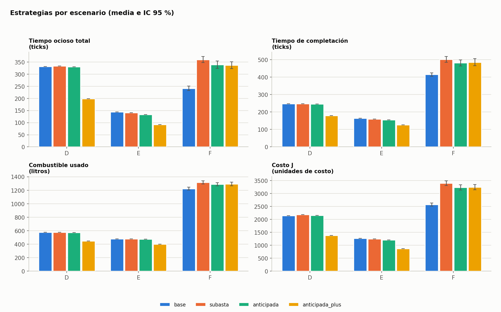
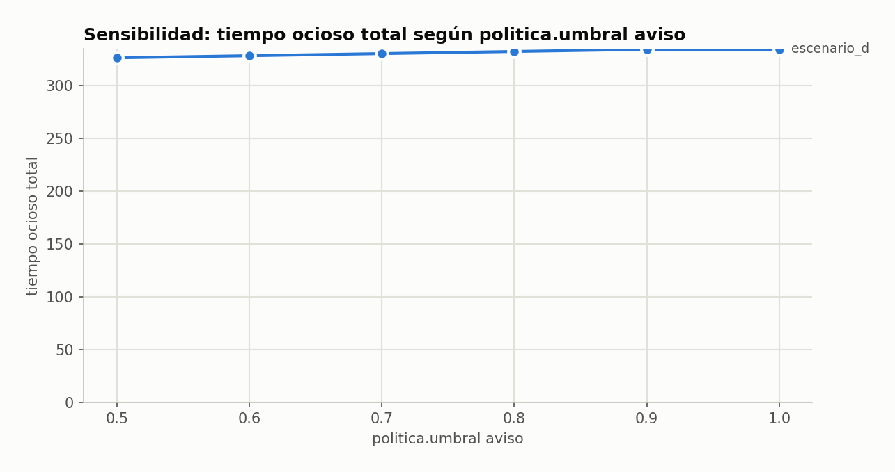
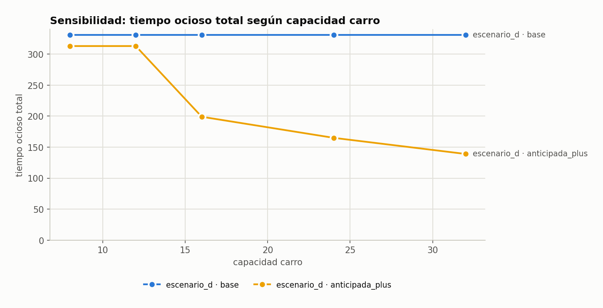
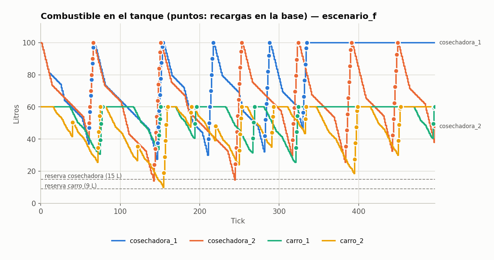
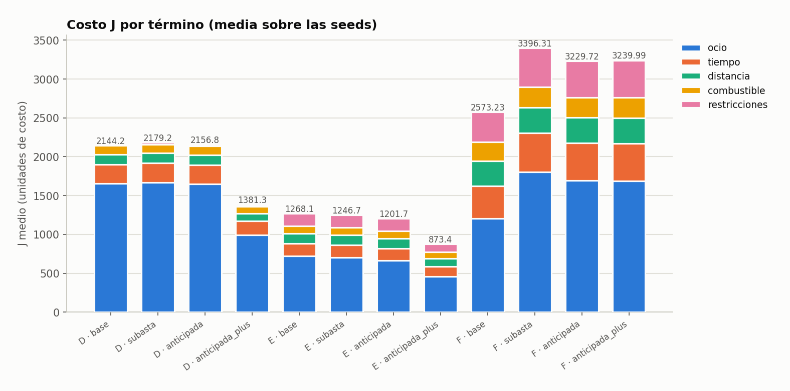
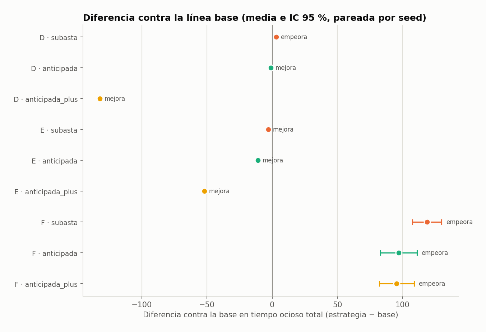

# Resultados de la segunda entrega

> Generados con `development` después del PR #17. Para regenerarlos: `bash scripts/correr_todos.sh` y los experimentos de `config/experimentos/` con `python tools/correr_experimento.py <experimento>.json --procesos 8`. Las tablas y figuras salen de `runs/experimentos/<nombre>/`; las figuras de este documento están en `docs/figuras/entrega2/`.

## Qué se corrió

| Experimento | Escenarios | Estrategias | Variación | Corridas |
|---|---|---|---|---|
| `estrategias.json` (principal, spec §13) | D, E, F | las 4 | 20 seeds | 240 |
| `estrategias_incertidumbre.json` | D con incertidumbre moderada | las 4 | 20 seeds | 80 |
| `umbral_aviso.json` | D | anticipada | umbral 0.5 a 1.0 × 20 seeds | 120 |
| `capacidad_carro.json` | D | base y anticipada_plus | capacidad 8 a 32 × 20 seeds | 200 |

Las 640 corridas terminan, validan contra el esquema 2.2 y entregan el 100 % del grano, con **0 colisiones y 0 ticks bloqueados**. Sin incertidumbre, D y E son deterministas: sus 20 seeds dan el mismo resultado (IC = 0). Por eso se agregó la versión de D con incertidumbre: rendimiento 1–2, hasta 1 tick extra por operación y 10 % de mensajes con 1 tick de retraso.

## Estrategias (media de 20 seeds)

| Escenario | Estrategia | Completación (ticks; ± IC 95 %) | Ocio total (ticks) | Espera por ciclo | Combustible (L) | Costo J |
|---|---|---|---|---|---|---|
| D | base | 247 | 331 | 36.8 | 576 | 2144 |
| D | subasta | 248 | 334 | 37.1 | 576 | 2179 |
| D | anticipada | 246 | 330 | 36.7 | 574 | 2157 |
| D | **anticipada_plus** | **180** | **199** | **22.1** | **447** | **1381** |
| E | base | 165 | 144 | 18.0 | 481 | 1268 |
| E | subasta | 160 | 141 | 17.6 | 479 | 1247 |
| E | anticipada | 156 | 133 | 16.6 | 474 | 1202 |
| E | **anticipada_plus** | **127** | **92** | **11.5** | **402** | **873** |
| F | **base** | **415 ± 10** | **242 ± 9** | **13.4** | **1223** | **2573** |
| F | subasta | 502 ± 16 | 360 ± 13 | 20.1 | 1317 | 3396 |
| F | anticipada | 482 ± 17 | 339 ± 15 | 18.8 | 1287 | 3230 |
| F | anticipada_plus | 486 ± 21 | 337 ± 14 | 18.6 | 1293 | 3240 |

D con incertidumbre (diferencia pareada contra la base, IC 95 %):

| Estrategia | Ocio total | Completación | Costo J |
|---|---|---|---|
| subasta | +7.5 ± 1.2 (+1.3 %) | +3.3 ± 0.6 (+0.8 %) | +63 ± 7 (+1.8 %) |
| anticipada | +5.1 ± 1.3 (+0.9 %) | +2.1 ± 0.7 (+0.5 %) | +50 ± 8 (+1.4 %) |
| **anticipada_plus** | **−180 ± 10 (−31.7 %)** | **−92 ± 5 (−23.5 %)** | **−1041 ± 62 (−29.2 %)** |

Ningún intervalo cruza el 0, así que las tres diferencias son significativas: la de anticipada_plus es una mejora clara, y las de subasta y anticipada son un empeoramiento pequeño.

## Respuestas a las preguntas de la retro (semana 3)

**1. ¿Cuánto baja el ocio si el carro sale con la tolva al 70–80 %?**
Por sí solo, casi nada. En D el ocio baja de 334 ticks (umbral 1.0) a 330 (0.7) y 332 (0.8), entre 0.6 % y 1.2 % (`umbral_aviso.json`).

¿Por qué? Con un solo carro para dos cosechadoras, el cuello de botella es que el carro esté libre, no que se le avise antes. Después de cada transferencia va a la bodega y regresa a su base, así que el aviso anticipado casi siempre lo encuentra ocupado.

**2. ¿Qué pasa con la espera si el carro atiende dos tolvas antes de volver?**
Es la mejora grande. `anticipada_plus` encadena servicios (atiende otra tolva si le cabe) y atiende desde la bodega sin volver a su base. Con eso, la espera por ciclo baja de 36.8 a 22.1 ticks en D (−40 %) y de 18.0 a 11.5 en E (−36 %). En D con incertidumbre, el ocio total baja un 31.7 % ± 1.8 %.

**3. ¿Cómo se compara un Q-learning de despacho contra el umbral fijo?**
No está implementado en esta versión: la segunda entrega sustituyó el aprendizaje por refuerzo por el costo J con ablación (decisión del 2026-11-23). Queda como trabajo de la siguiente etapa, con la comparación contra el umbral fijo en los mismos escenarios y seeds.

**4. ¿Por qué la capacidad del carro no influía y cómo cambia si la política la usa?**
La política base descarga después de cada transferencia, así que nunca lleva más que una tolva. Por eso, en D, de 8 a 32 de capacidad el ocio queda igual: 331 ticks. Con `anticipada_plus`, que sí usa la capacidad, el ocio baja de 313 (capacidad 8) a 199 (16), 165 (24) y 139 (32), un 56 % menos.

## Escenario F: cuando la subasta pierde

En F (tanques chicos, rendimiento variable, duraciones y mensajes con retraso), la **línea base gana**: la subasta tiene un 49 % más de ocio. Hay tres causas:
- los carros rechazan servicios por la reserva de combustible y la cosechadora repite la llamada;
- la cosechadora espera más tiempo con el motor encendido;
- las vueltas a recargar se multiplican.

Es un resultado útil: la coordinación por subasta no es mejor siempre. Con recursos escasos, la asignación fija evita negociar y el costo de los rechazos.

## Costo J y ablación

Pesos por defecto (spec §11): tiempo 1, distancia 0.5, colisiones 1000, ocio 5, combustible 0.2 y restricciones 10. `anticipada_plus` tiene el menor J en D y E, y la base en F.

En la ablación (quitar un término a la vez), el orden de las estrategias solo cambia en un caso: en D, sin el término de restricciones, `anticipada` pasa delante de `base`. La diferencia entre las dos es de pocas unidades, y las restricciones registradas (esperas R3 de la subasta) son justo lo que las separa. El ganador no cambia en ningún escenario.

## Limitaciones conocidas

- **E con rendimiento variable:** una cosechadora puede llenarse justo en `(4, 2)`, la celda frente al único hueco del muro. Ahí espera al carro, y los dos carros se estorban en la fila de servicio. Pasa en 15 de 80 corridas de E con la incertidumbre del experimento de D; un caso para reproducirlo es la estrategia base con seed 9. El E de la especificación (sin incertidumbre) no lo tiene: 80 de 80 terminan sin BLOQUEO. Resolverlo requiere que la cosechadora no se detenga en un cuello de botella, o que un carro sin ruta ceda el paso a uno que sí la tiene.
- **Tanques en 0 L en F:** hay 9 ticks con un tanque en 0 L, en unos 40,000 ticks de F, cuando una cosechadora espera mucho a un carro que ya va en camino. R11 se cumple (nunca negativo) y queda un aviso en la consola.
- **Aprendizaje por refuerzo:** no implementado (pregunta 3).
