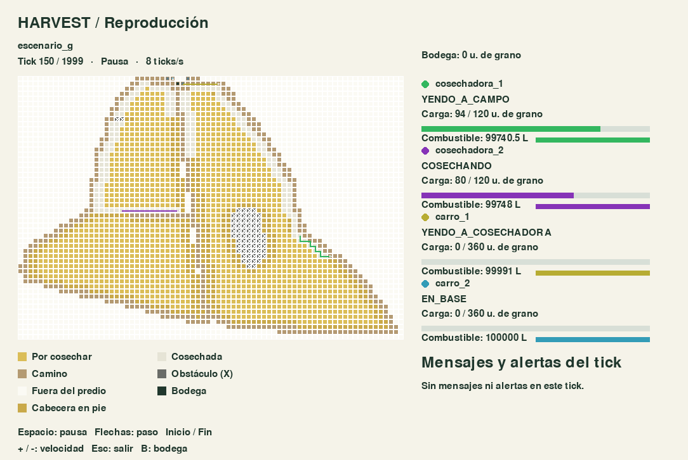
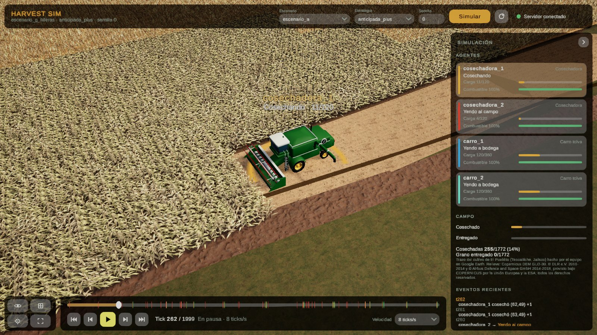

# Resultados: hileras reales y rutas de la industria

> Contrato: `docs/especificacion_terreno.md` §14 (trace 2.4). Decisiones: `docs/decisiones.md`, 2026-11-26. Para regenerar: `python tools/correr_experimento.py config/experimentos/hileras_g.json --procesos 14`; reglas con `python tools/verificar_terreno.py --movimiento hileras`.

## La pregunta

Antes, las cosechadoras se movían como si el maíz no tuviera dirección: entraban de lado a cada pasada nueva cortando las hileras, pisaban cultivo en pie y daban vueltas de 180° en un tick. ¿Qué cambia si se mueven como en la industria?

## Qué se tomó de la industria

| Referencia | Qué se usó |
|---|---|
| [Fields2Cover](https://github.com/Fields2Cover/Fields2Cover) ([artículo](https://arxiv.org/abs/2210.07838)), librería abierta de Wageningen para planear la cobertura de vehículos agrícolas | Su cadena de cuatro módulos (ver la lista siguiente) |
| [AgOpenGPS](https://github.com/AgOpenGPS-Official/AgOpenGPS), autoguiado abierto | Pasadas paralelas a una línea de referencia y vuelta en la cabecera |
| Literatura de vueltas en cabecera ([Wageningen](https://edepot.wur.nl/683852), [arXiv 2407.05979](https://arxiv.org/html/2407.05979v4)) | Vuelta en U si la separación d ≥ 2R; si no, Ω |
| *Hybrid A\** / *state lattice* | A* con rumbo para los traslados |

Los cuatro módulos de Fields2Cover que se implementaron:

1. **Cabecera** de ancho constante alrededor del lote.
2. **Pasadas** paralelas a las hileras.
3. **Orden de pasadas:** snake o boustrophedon.
4. **Vueltas** con curvas de Dubins.

La librería no se usa directamente: en PyPI solo está su código fuente, y habría que compilar C++ con GDAL y OR-tools. Sus pasos se implementaron sobre la cuadrícula de la simulación (`mapa/cobertura.py`, `mapa/dubins.py`, `rutas.astar_rumbo_tiempo`).

## Qué se corrió

- **`hileras_g.json`:** G con las 4 estrategias × 20 seeds × movimiento por `celdas` (el de siempre) o por `hileras` (160 corridas).
- **Supuestos** (`config.maquinas`):

| Máquina | Radio de giro | Velocidad |
|---|---|---|
| Cosechadora | 7.5 m | 6 km/h cosechando, 5 km/h en la vuelta |
| Carro | 6 m | 10 km/h |

- **Cabecera:** k = 2 celdas (24 m) en los extremos de las hileras.
- **Variación:** G no tiene incertidumbre, así que las 20 seeds dan lo mismo.

## Resultados

| Estrategia | Movimiento | Ticks | Ocio | Eficiencia de campo | Entradas de lado | Pasos sobre cultivo | Vueltas instantáneas | Combustible (L) |
|---|---|---|---|---|---|---|---|---|
| base | celdas | 1692 | 806 | 56.5 % | 102 | 23 | 10 | 6454 |
| base | **hileras** | 2184 | 794 | 43.8 % | **0** | **0** | **0** | 7757 |
| anticipada | celdas | 1481 | 390 | 65.2 % | 102 | 23 | 11 | 6395 |
| anticipada | **hileras** | 1996 | 470 | 47.6 % | **0** | **0** | **0** | 8036 |
| anticipada_plus | celdas | 1463 | 360 | 65.9 % | 102 | 23 | 11 | 6145 |
| anticipada_plus | **hileras** | 1966 | 433 | 48.1 % | **0** | **0** | **0** | 7925 |

(La subasta empata con la base en los dos movimientos.)

- **El movimiento es realista:**
  - nadie corta las hileras de lado fuera de la cabecera (antes 102 por corrida);
  - nadie pisa cultivo (antes 23);
  - no hay vueltas de radio 0 (antes 10–11).
  - En las 160 corridas: 0 colisiones, 0 bloqueos, 0 salidas del predio y 0 metros de carro sobre cultivo.
- **Cosechar respetando las hileras cuesta tiempo:**
  - la cosecha tarda entre 29 % y 35 % más, y la eficiencia de campo baja de ~65 % a ~48 %;
  - el combustible sube 20–29 %, porque el motor va encendido en las vueltas;
  - las 90 vueltas de cabecera duran de 4 a 9 ticks cada una (Ω de 37 m o U de 33 m), y abrir el campo cosecha primero el ~28 % del área: la cabecera.
- **Esto es lo que el modelo anterior escondía.** Con celdas, cambiar de pasada era gratis, así que la eficiencia de ~65 % era optimista: no contaba las vueltas ni la apertura del campo.
- **El orden de las estrategias no cambia:** con hileras, el despacho anticipado sigue bajando el ocio: 41 % contra la base (470 contra 794) y 45 % con `anticipada_plus` (433). Las conclusiones de la segunda entrega y de M1 se sostienen; los números absolutos son los que cambian.
- **El patrón de pasadas importa:** con el radio de 7.5 m y pasadas de 12 m, la pasada vecina exige una vuelta Ω (37 m) y saltar una permite una U (33 m). El orden por costo eligió snake en el lote A y en parte del C, y boustrophedon en el B.

En el visor, la cabecera de cada lote ya está abierta (el rastrojo de las orillas) antes de empezar las pasadas.

En Unity:
- la cosechadora avanza a lo largo de las hileras, a 0.76 m como en la siembra real;
- la franja de tierra marca la orilla de la cabecera;
- en cada vuelta, la máquina sigue la curva de Dubins que trae el trace (evento `TRAYECTORIA`), con una spline de Catmull-Rom.

## M1 con hileras

Las tablas de Q-learning y SARSA se reentrenaron sobre G con hileras. Contra el umbral fijo:
- **SARSA:** −13.6 % de ocio y −6.4 % de tiempo (1869 ticks, más rápido que `anticipada_plus` con 1966);
- **Q-learning:** −10.9 % de ocio y −2.0 % de tiempo.

Detalle en `docs/resultados_mejoras.md` §M1.

## Limitaciones

- **Una celda por tick para todos:** el carro debería ir más rápido que la cosechadora (10 contra 6 km/h). Su radio y su velocidad solo cuentan en el costo de los giros.
- **Cabecera de una celda en las orillas paralelas a las hileras:** es suficiente para pasar, pero en lotes angostos el carro puede quedar detrás de la cosechadora. Entonces se aparta de toda su ruta y espera. Esa espera sin plan, y el giro que acumula su avance aunque se replanee, se agregaron después de encontrar dos atascos al combinar hileras con despacho anticipado.
- **Descarga en marcha (fase H6):** pendiente. Hoy la cosechadora se detiene a transferir; en la industria el carro va al lado y ella sigue cosechando. Cambia la métrica principal, así que va con su propia bandera.
- **Supuestos sin calibrar con una máquina real:** el radio de giro y las velocidades son valores típicos. Medirlos en El Pueblito daría números absolutos más confiables.
