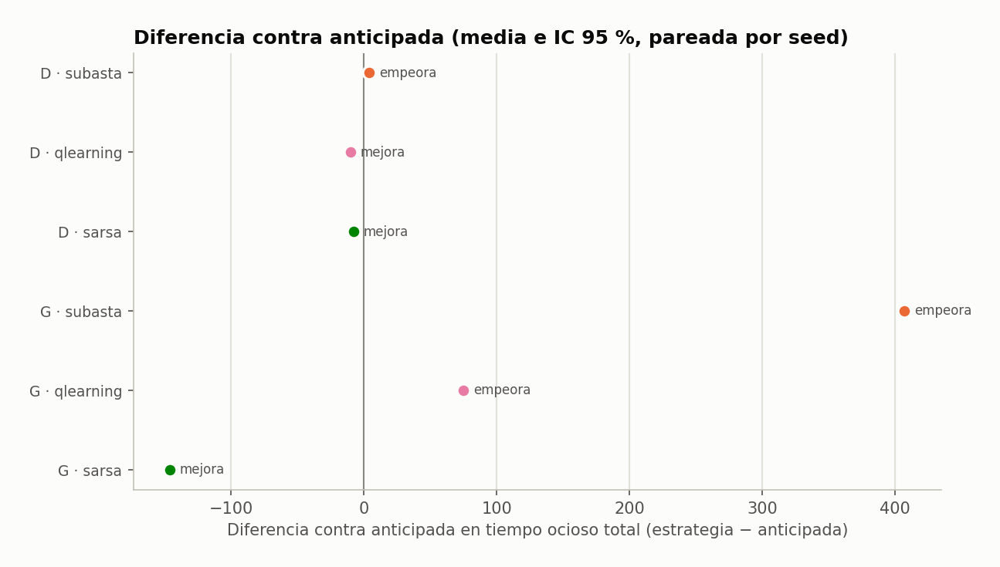
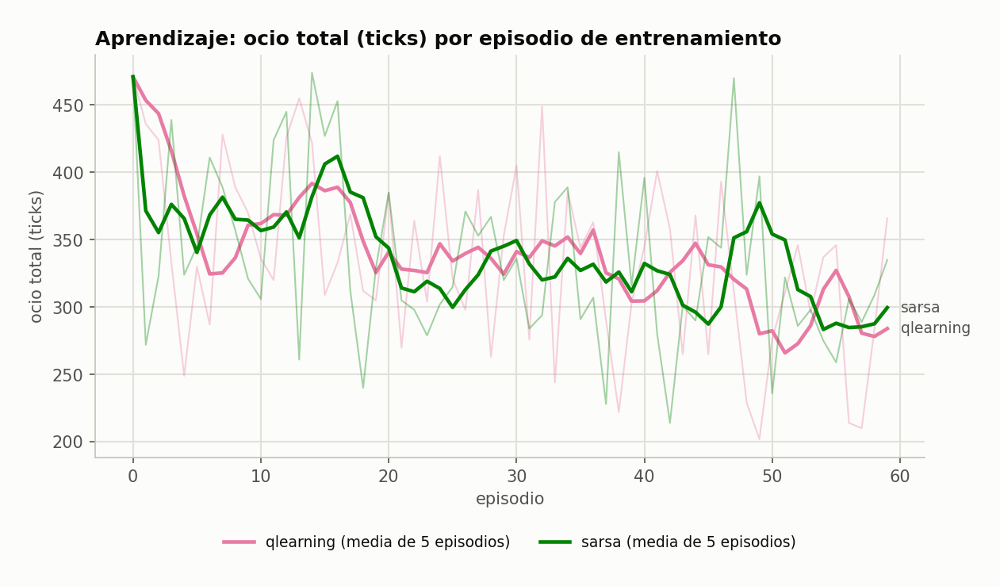
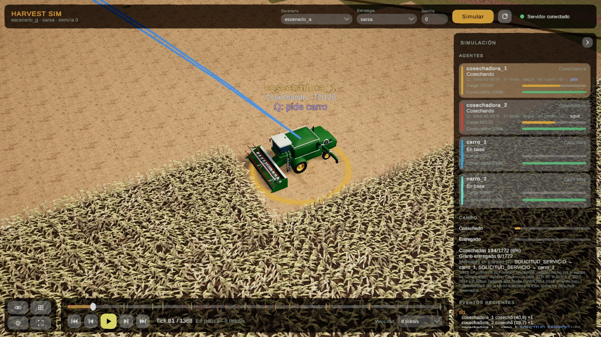

# Resultados de las mejoras (M1–M12)

> Formulación: `docs/especificacion_mejoras.md`. Plan: `docs/plan_terreno.md` §4b. Para regenerar, entrena las tablas con `tools/entrenar_despacho.py` y corre los experimentos de `config/experimentos/m1_*.json` con `tools/correr_experimento.py`. Las figuras están en `docs/figuras/mejoras/`.

## M1. Despacho aprendido (Q-learning y SARSA)

**Pregunta 3 de la retro:** ¿puede un agente aprender cuándo pedir el carro mejor que el umbral fijo?

**Respuesta:**
- **En el campo real, sí:** con SARSA, G baja su ocio un **37 %** contra el umbral fijo de 0.7 y termina un 7.6 % antes.
- **En D, la mejora es chica:** −2 % a −3 %. En D el momento del aviso casi no importa; hasta el mejor umbral fijo solo gana un 3 %.
- **Q-learning en G no convergió** en 60 episodios.

### Qué se corrió

- **Entrenamiento** (seeds 1000 y siguientes):
  - D: 500 episodios por algoritmo, unos 80 s;
  - G: 60 episodios por algoritmo, unos 21 min.
  - En los dos, ε baja de 0.2 a 0.01. Las tablas están en `config/aprendizaje/`.
- **Evaluación** (seeds 0 a 19, sin exploración), pareada contra `anticipada` (la misma política, salvo el aviso):
  - `m1_despacho.json`: D y G (160 corridas). D y G no tienen incertidumbre, así que las 20 seeds dan lo mismo y el IC 95 % es 0.
  - `m1_despacho_incertidumbre.json`: D con incertidumbre (80 corridas). Las seeds varían, así que el IC 95 % es real, y además la tabla se entrenó sin incertidumbre (generalización).
- Todas las corridas terminan, validan y entregan el 100 % del grano.

### Resultados (media de 20 seeds; diferencia contra `anticipada`)

| Escenario | Estrategia | Ocio total | Completación (ticks) | Costo J | Combustible |
|---|---|---|---|---|---|
| D | anticipada (umbral 0.7) | 330 | 246 | 2157 | 574 |
| D | subasta (umbral 1.0) | 334 (+1.2 %) | 248 (+0.8 %) | 2179 (+1.0 %) | 576 |
| D | **qlearning** | **320 (−3.0 %)** | **241 (−2.0 %)** | **2101 (−2.6 %)** | 569 |
| D | sarsa | 322 (−2.4 %) | 242 (−1.6 %) | 2112 (−2.1 %) | 570 |
| D con incertidumbre | anticipada | 573.5 | 392.3 | 3615 | 825 |
| D con incertidumbre | qlearning | −4.5 ± 1.6 (−0.8 %) | −2.3 ± 0.8 | −25 ± 9 | −2.3 |
| D con incertidumbre | sarsa | −2.2 ± 1.8 (−0.4 %) | −1.1 ± 0.9 | −12 ± 10 | −1.1 |
| G | anticipada (umbral 0.7) | 390 | 1481 | 6785 | 6395 |
| G | subasta (umbral 1.0) | 797 (+104 %) | 1701 (+14.9 %) | 8968 (+32 %) | 6452 |
| G | qlearning | 465 (+19 %) | 1462 (−1.3 %) | 7522 (+11 %) | 6874 (+7.5 %) |
| G | **sarsa** | **244 (−37 %)** | **1368 (−7.6 %)** | **6224 (−8.3 %)** | 6706 (+4.9 %) |

En D con incertidumbre, los IC 95 % de las dos estrategias aprendidas no cruzan el 0: las mejoras son significativas, aunque pequeñas.

**Referencia: qué tan lejos está del mejor umbral fijo.** Barrido de `umbral_aviso` con la estrategia anticipada (una seed; D y G son deterministas):

| Umbral | 0.1 | 0.3 | 0.5 | 0.7 | 0.9 | 1.0 |
|---|---|---|---|---|---|---|
| G: ocio | **184** | 198 | 378 | 390 | 617 | 797 |
| G: ticks | **1339** | 1369 | 1415 | 1481 | 1605 | 1701 |
| D: ocio | **320** | 324 | 326 | 330 | 334 | 334 |

- **En G, SARSA cierra el 71 % de la brecha** entre el umbral de 0.7 y el mejor umbral fijo: (390 − 244) / (390 − 184).
  - Se queda corto del umbral de 0.1, que en G es pedir carro casi al vaciar la tolva: los traslados son tan largos que conviene que el carro salga casi de inmediato.
  - El agente no sabe qué umbral fijo es el mejor: lo descubre solo a partir de la recompensa.
- **En D, Q-learning llega exactamente al mejor umbral fijo (320).**

### Curvas de aprendizaje

- **En G**, la media de 10 episodios baja de 372 a 299 (Q-learning) y de 365 a 292 (SARSA) entre los primeros y los últimos 10.
  - La curva es ruidosa: cada episodio explora y una sola llamada tarde cuesta mucho ocio en G.
  - Con 60 episodios Q-learning no se estabiliza. Su política voraz depende de los últimos episodios y quedó peor que la de SARSA.
- **En D** (`figuras/mejoras/m1_curva_escenario_d.png`), las dos curvas son casi planas: hay muy poco que aprender.

### Tabla aprendida (resumen)

Porcentaje de las visitas a cada tramo de la tolva en que la tabla prefiere **pedir carro**. Se omiten los estados con empate, que usan el umbral, y el tramo 5 (llena), donde pedir es forzoso.

| Tabla | Estados | Tramo 0 (0–20 %) | 1 (20–40 %) | 2 (40–60 %) | 3 (60–80 %) | 4 (80–100 %) |
|---|---|---|---|---|---|---|
| G, SARSA | 75 | 31 % | 30 % | 39 % | 51 % | 82 % |
| G, Q-learning | 74 | 0 % | 33 % | 50 % | 22 % | 65 % |
| D, SARSA | 31 | 0 % | 11 % | 4 % | 90 % | 70 % |
| D, Q-learning | 31 | 11 % | 10 % | 4 % | 60 % | 79 % |

- **En G, SARSA aprende a pedir pronto en una parte de las situaciones:** en los tramos 0 a 2 ya pide en un tercio de las visitas. Cuáles son (carros libres, distancia, otra cosechadora) se ve en la tabla.
- **En D, las dos tablas casi nunca piden antes del 60 %.**

### Lo que se aprendió en el camino

Tres errores de diseño, encontrados y corregidos antes de los resultados finales:

1. **Decidir en cada celda no funciona.**
   - Pedir una celda más tarde cambia el ocio en décimas de tick, y esa diferencia se pierde en el ruido de la actualización.
   - Además, con γ = 0.95 el costo de pedir tarde llegaba unas 50 decisiones después, descontado a 0.08.
   - Resultado: las dos políticas aprendían a pedir tarde; en G, Q-learning daba 614 de ocio y SARSA 543, contra 390 del umbral fijo.
   - Se pasó a una decisión por tramo de la tolva y a γ = 0.999.
2. **En el estado forzado (tolva llena) Q-learning tomaba el máximo sobre las dos acciones.**
   - «Seguir» no existe ahí y su Q nunca se actualizaba, así que valía 0 y el cliff salía gratis.
   - Q-learning en D aprendía a no pedir nunca (334, igual que la subasta).
   - Ahora el objetivo usa la única acción posible. Hay prueba: `test_q_learning_no_toma_el_maximo_en_el_estado_forzado`.
3. **El carro encerraba a la cosechadora** cuando el aviso temprano lo hacía llegar durante un traslado (ver `docs/decisiones.md`, 2026-11-26).
   - Las estrategias fijas no lo habían mostrado.
   - El arreglo no cambia ninguna métrica publicada de A–G.

Q-learning contra SARSA muestra el contraste clásico del cliff:
- Antes del arreglo 2, Q-learning (off-policy) terminaba cayendo en el cliff mientras exploraba (hasta 8 por episodio al final del entrenamiento en D).
- SARSA (on-policy) aprende el costo de explorar cerca del borde y lo evita.

### En Unity

Unity reproduce las corridas de `qlearning` y `sarsa` y muestra cada decisión de la tabla, sin decidir nada: todo sale del evento `DECISION_DESPACHO` del trace (GioMax102/harvest-simu-visualization PR #6, EditMode 69/69).

- **Placa del agente:** «Q: pide carro» en el tick en que la cosechadora pide. Si decidió el respaldo, dice «Umbral»; si se llenó sin carro (cliff), «Tolva llena».
- **Tarjeta del agente:** la última decisión con su estado y los valores Q, por ejemplo «Q · tolva 60–80 % · 2+ libres · seguir −48 / pedir −46 → pide».
- **Selector de estrategia:** se llena con lo que el servidor puede correr en cada escenario; `qlearning` y `sarsa` solo aparecen en D y G, que tienen tabla.
- **Panel de métricas:** decisiones Q, pedidos por la tabla o por el umbral, y veces que la tolva se llenó sin carro.
- **Cuántas decisiones son:** en G con SARSA, 41 en toda la corrida. 14 pedidos salen de la tabla, ninguno del respaldo, y hay 2 cliffs.

En el tick 81, la cosechadora 1 tiene la tolva al 60–80 % y los dos carros libres. La tabla vale −48 para seguir y −46 para pedir, así que pide (las líneas azules son su llamada a los dos carros). La cosechadora 2, con la tolva al 40–60 %, sigue cosechando.

### Con hileras reales (G con `movimiento = "hileras"`)

Con el movimiento por hileras (`docs/resultados_hileras.md`) la cosechadora abre la cabecera, cosecha a lo largo de las hileras y da vueltas con radio de giro, así que las tablas se reentrenaron en `escenario_g_hileras`: 60 episodios por algoritmo, seeds 1000 y siguientes. El experimento es `m1_despacho_hileras.json`: 20 seeds, pareado contra `anticipada`.

| Estrategia | Ocio total | Completación (ticks) | Costo J | Combustible |
|---|---|---|---|---|
| anticipada (umbral 0.7) | 470 | 1996 | 8483 | 8036 |
| subasta (umbral 1.0) | 821 (+75 %) | 2200 (+10 %) | 10201 (+20 %) | 7767 |
| qlearning | 419 (−10.9 %) | 1956 (−2.0 %) | 8256 (−2.7 %) | 8161 (+1.6 %) |
| **sarsa** | **406 (−13.6 %)** | **1869 (−6.4 %)** | **8224 (−3.1 %)** | 8312 (+3.4 %) |

- **El aprendizaje sigue ganándole al umbral fijo, pero por menos que con celdas** (SARSA −13.6 % de ocio contra −37 %). Con hileras, buena parte del tiempo se va en vueltas y en abrir el campo, y eso no depende de cuándo se pide el carro.
- **SARSA con hileras (1869 ticks) termina antes que `anticipada_plus` (1966)**, que además atiende desde la bodega y encadena servicios.
- **Q-learning ahora sí mejora** (en G por celdas no convergía en 60 episodios). No se midió por qué; puede ser la otra dinámica del movimiento o simple variación entre entrenamientos.
- **Ninguna estrategia aprendida pisa cultivo ni da vueltas de radio 0:** las reglas de hileras (R14, A* con rumbo) se cumplen sin importar quién decide el despacho.

### Limitaciones

- **Una tabla por escenario:** no se probó si la de G sirve en otro campo real.
- **Pocos episodios en G:** con 60, Q-learning no convergió. Más episodios cuestan unos 21 min cada 60.
- **G es determinista:** las comparaciones en G tienen IC 0. Falta G con incertidumbre.
- **La recompensa solo mira el ocio de la cosechadora que decide**, no el del sistema. Pedir temprano usa más combustible (+4.9 % en G con SARSA), porque el carro sale antes y espera más. Ese costo está en J pero no en la recompensa.
