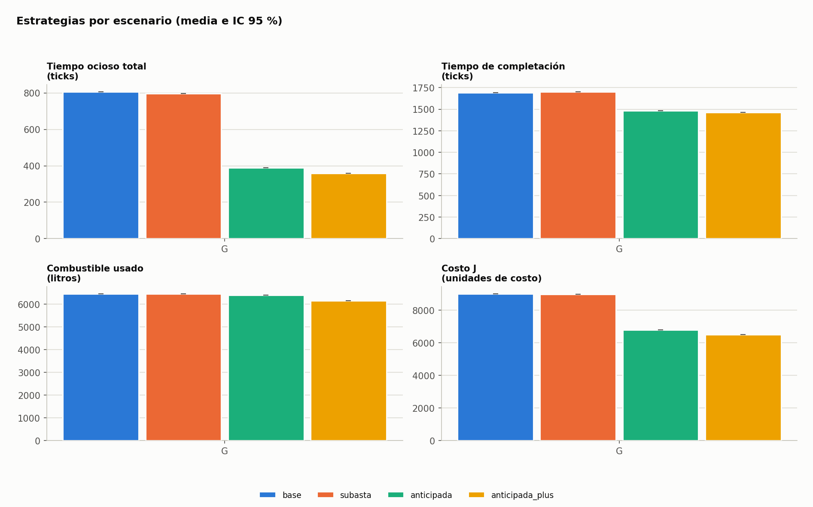
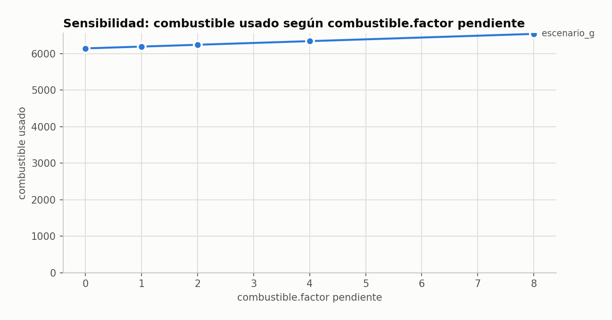

# Resultados del terreno real (escenario G, El Pueblito)

> Plan: `docs/plan_terreno.md` (P7). Contrato: `docs/especificacion_terreno.md`. Para regenerar:
> `python tools/correr_experimento.py config/experimentos/<experimento>.json --procesos 8`. Las tablas salen de
> `runs/experimentos/<nombre>/` y las reglas se revisan con `python tools/verificar_terreno.py`.

## Qué se corrió

| Experimento | Estrategias | Variación | Corridas |
|---|---|---|---|
| `terreno_g_estrategias.json` (principal) | las 4 | 20 seeds | 80 |
| `terreno_g_pendiente.json` | anticipada_plus | factor de pendiente 0, 1, 2, 4 y 8 × 20 seeds | 100 |
| `terreno_g_r13.json` | las 4 | con R13 y sin R13 × 20 seeds | 160 |

Las 340 corridas terminan y entregan el 100 % del grano. Las 80 de `tools/verificar_terreno.py` (con R13) tienen 0 colisiones, 0 BLOQUEO, 0 celdas fuera de campo (R12) y 0 metros de carro sobre cultivo en pie.

G no tiene incertidumbre, así que las 20 seeds dan exactamente el mismo resultado y el IC 95 % es 0. Por eso las diferencias de abajo son exactas para este campo, pero no dicen nada sobre la variabilidad (ver «Limitaciones»).

**Compactación del suelo** (métrica nueva, `metricas.suelo_de_carros`): cada vez que un carro cambia de celda se cuentan 12 m (`tamano_celda_m`) según el suelo de la celda a la que entra:

- **rastrojo:** campo ya cosechado; es el suelo que se compacta;
- **cultivo:** campo todavía en pie; con R13 debe dar 0;
- **camino:** caminos, patio de la bodega y bases; este suelo ya está compactado.

Se calcula desde el log, sin campos nuevos en el trace, y solo aparece cuando el trace trae mapa (2.3).

## Estrategias en el campo real

| Estrategia | Completación (ticks) | Ocio total (ticks) | Combustible (L) | Costo J | Carros: camino (m) | Carros: rastrojo (m) | % sobre rastrojo |
|---|---|---|---|---|---|---|---|
| base | 1692 | 806 | 6454 | 9004 | 9816 | 8064 | 45.1 % |
| subasta | 1701 | 797 | 6452 | 8968 | 9816 | 8088 | 45.2 % |
| anticipada | 1481 | 390 | 6394 | 6794 | 10500 | 9132 | 46.5 % |
| **anticipada_plus** | **1463** | **360** | **6144** | **6500** | 8040 | 8808 | 52.3 % |

- **El despacho anticipado es lo que más importa en el campo real.**
  - Baja el ocio de 806 a 390 ticks (−52 %) y la completación un 12 %.
  - anticipada_plus baja el ocio un 55 % y el costo J un 28 %.
  - En los escenarios A–F la ganancia era menor porque los traslados eran cortos. Aquí el carro tarda en llegar desde la bodega, así que salir antes rinde más.
- **La subasta empata con la base:** con 2 carros, la subasta reparte los servicios casi igual que la regla del carro más cercano.
- **anticipada_plus pisa menos camino, pero más rastrojo:**
  - Recorre 1776 m menos de camino que la base, porque atiende desde la bodega y encadena servicios.
  - Recorre 744 m más de rastrojo, porque va directo a la siguiente cosechadora por el campo cosechado.
  - Para el dueño, la estrategia más rápida es también la que más compacta el suelo cosechado.

## Relieve: factor de pendiente

El consumo por celda se multiplica por `1 + f · pendiente` (solo en subida; `docs/especificacion_terreno.md` §8). El campo va de 1705 a 1716 m, con una pendiente media de 1.5 % y un p95 de 5.2 %.

| f | 0 | 1 | 2 | 4 | 8 |
|---|---|---|---|---|---|
| Combustible (L) | 6144 | 6193 | 6243 | 6342 | 6541 |
| Cambio contra f = 0 | — | +0.8 % | +1.6 % | +3.2 % | +6.5 % |
| Completación (ticks) | 1463 | 1463 | 1463 | 1463 | 1463 |

- El combustible sube de forma lineal: cerca de 0.8 % por cada unidad de f.
- El tiempo no cambia, porque el tanque alcanza y ninguna máquina tiene que ir a recargar.
- El relieve de El Pueblito es suave, así que con el valor por defecto (f = 2) cuesta 1.6 %. En un campo con más pendiente o con tanques chicos, el relieve sí cambiaría las rutas y los tiempos.

## R13: no pisar el cultivo en pie

Diferencia de **sin R13 contra con R13**. Positivo significa que, sin R13, sube.

| Estrategia | Completación (ticks) | Ocio total | Carros sobre cultivo (m) | Carros sobre rastrojo (m) | Combustible (L) |
|---|---|---|---|---|---|
| base | −24 (−1.4 %) | 0 | 0 | 0 | −72 |
| subasta | −24 (−1.4 %) | 0 | 0 | 0 | −72 |
| anticipada | −20 (−1.4 %) | −8 | **+348** | −420 | −95 |
| anticipada_plus | −32 (−2.2 %) | −25 | **+864** | −1440 | −129 |

- **Lo que cuesta respetar el cultivo es poco: entre 1.4 % y 2.2 % más de tiempo.**
  - La política también hace que las cosechadoras, en sus traslados entre zonas, rodeen el cultivo de la otra.
  - En base y subasta ese es todo el efecto. Sus carros solo salen cuando la cosechadora ya está llena, y para entonces el rastrojo une el camino con ella, así que nunca pisarían cultivo.
- **Con despacho anticipado, sin R13 los carros sí cortan por el maíz:**
  - anticipada pasa 348 m sobre cultivo en pie (29 celdas) y anticipada_plus 864 m (72 celdas).
  - Ese es el suelo con cultivo que R13 deja de compactar y el maíz que deja de tumbar.
  - A cambio, sin R13 se ahorran 20 a 32 ticks y 95 a 129 L.
- **Matiz:** sin R13 el carro pisa menos rastrojo (−1440 m en anticipada_plus) porque corta camino. Con R13 el suelo de campo recorrido en total es un poco mayor (8808 m contra 8232 m), pero todo es rastrojo, que ya se cosechó y donde el daño al cultivo es nulo.

## Reglas del terreno (P5, revisadas otra vez)

`tools/verificar_terreno.py` con las 4 estrategias × 20 seeds: 0 colisiones, 0 BLOQUEO, 0 R12 y 0 carros sobre cultivo. Una cosechadora pisa cultivo sin cosecharlo 23 ticks por corrida: son traslados en bordes irregulares sin ruta por rastrojo, y quedan en `cruces_cultivo`.

## Criterios del plan

| Criterio | Resultado | Evidencia |
|---|---|---|
| C1 área | 1772 celdas de campo, −2.6 % contra el KML (límite 5 %) | `tests/test_mapa.py::test_area_dentro_de_la_tolerancia` |
| C2 obstáculos y fuera de campo | 0 en las 80 corridas de G (4 estrategias × 20 seeds) | `tests/test_terreno_integracion.py`, `tools/verificar_terreno.py` |
| C2b red de caminos | Una sola componente que toca la bodega y los 3 lotes | `tests/test_mapa.py::test_caminos_forman_una_red_que_toca_cada_lote` |
| C2c carros sin cultivo | 0 m sobre cultivo con R13 | `metros_carro_cultivo`, `test_suelo_de_carros_en_g` |
| C6 nada se rompe | 711 pruebas en Python (A–F iguales, `test_regresion`); Unity EditMode 55/55 | CI de GitHub Actions; harvest-simu-visualization PR #5 |

## Limitaciones

- **G es determinista:** las 20 seeds son idénticas. Falta una versión de G con incertidumbre (rendimiento variable y retrasos) para tener intervalos de confianza reales.
- **El DEM es un modelo de superficie (DSM):** incluye árboles y construcciones. Dentro del campo el efecto es menor, pero en la orilla sobreestima la pendiente.
- **La compactación cuenta metros, no peso:** no distingue un carro lleno de uno vacío ni el número de pasadas sobre la misma celda.
- **Unity PlayMode no se corrió en batch:** solo se corrió EditMode. La panorámica de la captura en batch sale negra también con traces 2.2.
