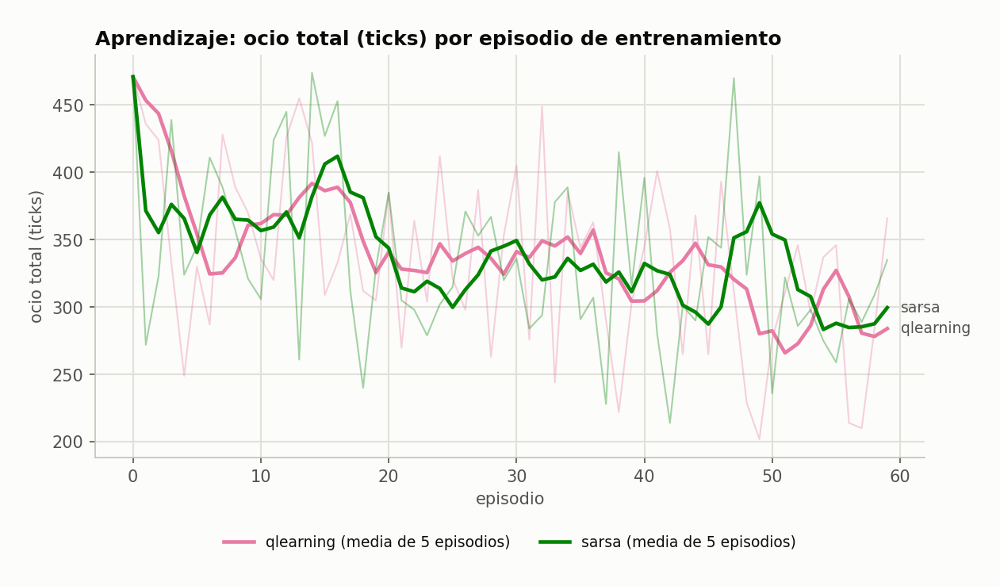

# Temas del curso TC2008B en harvest_sim

26 de noviembre de 2026

## Resumen

harvest_sim usa casi todo el temario de Sistemas Multiagentes del curso y la parte de Unity de Gráficas Computacionales. El resultado más fuerte es del campo real (El Pueblito): el despacho anticipado baja el ocio de las cosechadoras un 52 %, y el despacho aprendido con SARSA lo baja otro 37 %.

El proyecto simula cosechadoras y carros recolectores que se coordinan por mensajes en una cuadrícula. Python es la única fuente de verdad: cada corrida escribe un log (`trace.json`) y todo lo demás (métricas, gráficas, experimentos, dashboard y Unity) solo lee ese log. Hay siete escenarios: A–F son campos de prueba y G es el cultivo real de El Pueblito (Teocaltiche, Jalisco), sacado de un KML.

| Tema del curso | Dónde se usa | Resultado principal |
| --- | --- | --- |
| Agentes inteligentes (reactivos e híbridos) | Cosechadora y carro como máquinas de estados (`cosechadora.py`, `carro.py`) | 0 colisiones en todas las corridas; 100 % del grano entregado |
| Comunicación (KQML / FIPA-ACL, ontología) | Buzón con 7 performativas y retraso aleatorio (`mensajes.py`, `datos/formato.py`) | Todo mensaje y su acto comunicativo quedan en el log |
| Negociación: Contract Net (subastas) | Estrategias `subasta`, `anticipada` y `anticipada_plus` | En D y E, `anticipada_plus` baja el ocio entre 36 % y 40 %; en F la subasta pierde contra la base |
| Coordinación y restricciones | Rutas en el tiempo con reservas y reglas R1–R13 | 0 salidas del predio y 0 m de carro sobre cultivo en pie en G |
| Teoría de la decisión y utilidad | Costo J (tiempo, distancia, colisiones, ocio, combustible, restricciones) | En G, `anticipada_plus` baja J un 28 % |
| Aprendizaje por refuerzo | Q-learning y SARSA para decidir cuándo pedir carro (mejora M1) | En G, SARSA baja el ocio un 37 % contra el umbral fijo |
| Evaluación sin matemáticas analíticas | Escenarios, 20 seeds, IC 95 %, comparación pareada, reproducibilidad byte a byte | 1,232 corridas reportadas; 742 pruebas automáticas |
| Gráficas computacionales | Vista 3D en Unity: mallas, relieve (heightmap), transformaciones, materiales, API REST | El Pueblito en 3D con su relieve y caminos reales; 69 pruebas EditMode |
| Equilibrio de Nash (teoría de juegos) | Mejora M2 | Pendiente |

## 1. Agentes inteligentes (M1 del curso)

Cada máquina es un agente híbrido: reacciona a lo que percibe en cada tick, pero también planea (rutas, despacho anticipado) y guarda memoria (servicios en cola, su última espera).

**Qué es un agente en el curso:** algo que percibe su entorno, actúa sobre él y persigue un objetivo, con cierta autonomía. El curso distingue agentes de razonamiento deductivo, de razonamiento práctico, reactivos e híbridos (Wooldridge, caps. 2–5).

**Cómo se usa en el proyecto:**

| Agente | Percibe | Actúa | Objetivo | Estados (máquina de estados finitos) |
| --- | --- | --- | --- | --- |
| Cosechadora | Su tolva, su combustible, las celdas vecinas, los mensajes de los carros | Cosecha, se mueve, pide carro, adjudica el servicio, transfiere | Cosechar su zona sin quedarse esperando | `EN_BASE`, `YENDO_A_CAMPO`, `COSECHANDO`, `LLENA_ESPERANDO`, `TRANSFIRIENDO`, `REGRESANDO_A_BASE`, `FIN` |
| Carro recolector | Su carga, la posición de la cosechadora que atiende, los mensajes | Oferta, va a la cosechadora, recibe el grano, descarga en la bodega | Atender servicios y llevar todo el grano a la bodega | `EN_BASE`, `YENDO_A_COSECHADORA`, `ESPERANDO_TRANSFERENCIA`, `YENDO_A_BODEGA`, `DESCARGANDO`, `REGRESANDO_A_BASE` |

- **Reactivo:** en la línea base (primera entrega) el carro sale solo cuando la cosechadora ya está llena. Es una regla estímulo–respuesta.
- **Híbrido:** desde la segunda entrega, la cosechadora avisa antes de llenarse (umbral de aviso), estima si le alcanza el combustible para la siguiente carga y regresa a recargar si no. El carro planea su ruta en el tiempo y encadena servicios.
- **Ciclo de cada tick:** se entregan los mensajes del tick anterior, actúan las cosechadoras, después los carros, y se registra lo que cambió. Un mensaje enviado en el tick t se lee en t+1.
- **Ontología:** los agentes se nombran con el vocabulario del curso y de IEEE 1872 / 1872.2 (`AutonomousAgriculturalRobot`); las celdas con IEEE 1873 (`SemanticMapCell`); el log es un `AccountabilityRecord` (IEEE 7007). Detalle en `docs/ontologia.md`.

**Resultado:** en la primera entrega, la línea base reactiva entrega el 100 % del grano sin colisiones, pero la cosechadora pasa entre 37 % y 58 % del tiempo esperando al carro (escenarios A, B y C). Ese ocio es lo que justifica pasar a agentes híbridos y a coordinación.

## 2. Comunicación y negociación entre agentes

Los agentes no comparten memoria: solo se coordinan por mensajes con performativas al estilo KQML / FIPA-ACL. La asignación de carros se negocia con el protocolo Contract Net.

**Qué vio el curso:** métodos de comunicación (directa, estigmergia, pizarrón o *blackboard*, *broadcast*, Contract Net, enjambre, por eventos, entre pares), KQML (performativa + contenido + ontología) y las subastas como mecanismo de asignación de tareas.

**Cómo se usa:**

- **Comunicación directa con buzón:** cada mensaje tiene emisor, receptor, tick de envío, payload y performativa. Un mensaje enviado en t se entrega en t+1; con incertidumbre, un porcentaje llega con retraso (por ejemplo, 10 % con 1 tick extra en F).
- **Las 7 performativas:**

| Mensaje | Performativa | Quién → quién | Para qué |
| --- | --- | --- | --- |
| `LLENA` | request | cosechadora → su carro | Pedir que venga (línea base) |
| `SOLICITUD_SERVICIO` | cfp | cosechadora → todos los carros | Llamada a propuestas |
| `PROPUESTA` | propose | carro → cosechadora | Ofrecer su costo (ticks hasta llegar) |
| `RECHAZO` | refuse | carro → cosechadora | No puede: sin capacidad, sin combustible o sin ruta |
| `ACEPTACION` | accept-proposal | cosechadora → ganador | Adjudicar el servicio |
| `RECHAZO_PROPUESTA` | reject-proposal | cosechadora → los demás | Descartar las otras ofertas |
| `TRANSFERENCIA_TERMINADA` | inform | cosechadora → carro | Avisar que terminó de pasar el grano |

- **Contract Net:** la cosechadora es la administradora (*manager*) y los carros, los contratistas.
    1. La cosechadora anuncia el servicio (`cfp`) al llegar al umbral de aviso.
    2. Cada carro calcula su costo: los ticks para atender lo que ya tiene en cola y luego llegar junto a ella.
    3. Pasados 2 ticks, la cosechadora adjudica al menor costo (empate: el menor id) y rechaza a los demás.
    4. Sin propuestas, reintenta a los 3 ticks con un servicio nuevo.
- **Variantes de estrategia:** `subasta` (Contract Net al llenarse), `anticipada` (Contract Net al 70 % de la tolva) y `anticipada_plus` (además, el carro atiende desde la bodega sin volver a su base y encadena dos tolvas si le caben).

**Resultados (20 seeds):**

- **Avisar antes, por sí solo, casi no ayuda:** en D el ocio baja de 334 a 330 ticks (−1.2 %). Con un carro para dos cosechadoras, el cuello de botella es que el carro esté libre, no el aviso.
- **Encadenar servicios sí:** `anticipada_plus` baja la espera por ciclo de 36.8 a 22.1 ticks en D (−40 %) y de 18.0 a 11.5 en E (−36 %).
- **La subasta no siempre gana:** en F (tanques chicos, rendimiento variable y mensajes con retraso), la línea base termina en 415 ticks y la subasta en 502 (+21 %). Los carros rechazan por la reserva de combustible y la cosechadora repite la llamada; con recursos escasos, negociar cuesta más de lo que aporta.
- **En el campo real (G):** la subasta empata con la base (797 contra 806 de ocio) y el despacho anticipado lo baja a 390 (−52 %), porque los traslados desde la bodega son largos.

## 3. Coordinación, rutas y restricciones de seguridad

Varios agentes comparten el mismo campo sin chocar porque reservan sus celdas en el tiempo y porque 13 reglas físicas se revisan en cada tick. En las 1,232 corridas de los experimentos no hubo ninguna colisión.

**Qué vio el curso:** el ejercicio «agentes que se comunican» pide agregar reglas para evitar colisiones y una técnica de comunicación que mejore la cooperación. Las preguntas de diseño del curso piden saber qué agente puede hacer algo irreversible y qué barreras lo frenan, y si hay trazabilidad.

**Cómo se usa:**

- **Rutas:** BFS determinista (vecinos en orden N, E, S, O). Con varios agentes, BFS en el espacio-tiempo: cada agente reserva las celdas por las que pasará en los próximos ticks y los demás planean alrededor. Un plan vigente se cumple, para que replanear cada tick no posponga la salida para siempre.
- **Reparto del campo:** franjas por cosechadora en A–F; en G, lotes completos repartidos entre las cosechadoras y recorridos en serpentina (*boustrophedon*) desde la orilla que toca un camino.
- **Reglas R1–R13:**
    1. R1–R9 (primera entrega): dentro del mapa, un paso por tick, nunca dos agentes en la misma celda, no intercambiarse de lugar, transferir solo entre vecinos, respetar capacidades, conservar el grano, cosechar cada celda una vez y la cosechadora no entra a la bodega.
    2. R10 y R11 (segunda entrega): nadie entra a un obstáculo; el combustible nunca es negativo.
    3. R12 y R13 (campo real): nadie sale del predio; los carros no pisan el cultivo en pie (solo caminos y rastrojo).
- **Trazabilidad:** cada vez que una regla cambia una decisión, queda un evento `RESTRICCION` en el log con la regla, el agente y el detalle. Cada tick lleva un checksum SHA-256.

**Resultados:**

- 0 colisiones y 0 bloqueos en las 640 corridas de la segunda entrega y en las 80 de G que revisa `tools/verificar_terreno.py`; 0 salidas del predio y 0 m de carro sobre cultivo en pie.
- Respetar el cultivo (R13) cuesta entre 1.4 % y 2.2 % más de tiempo en G. Sin R13, los carros con despacho anticipado pasan hasta 864 m sobre maíz sin cosechar.
- La métrica de compactación (metros de carro sobre camino, rastrojo y cultivo) muestra el compromiso: la estrategia más rápida en G es también la que más rastrojo pisa (52 % de su recorrido).
- Un caso que no apareció con las estrategias fijas: al explorar en la mejora M1, un carro que llegaba temprano podía encerrar a la cosechadora en un pasillo junto a la arboleda. Se corrigió haciendo que el carro no se detenga en el paso de una cosechadora que se traslada; ninguna métrica publicada cambió.

## 4. Teoría de la decisión y teoría de juegos

Cada corrida se resume en un solo número de utilidad, el costo J, que permite decir qué estrategia es mejor y por qué. El equilibrio de Nash todavía no está implementado: es la mejora M2.

**Qué vio el curso:** teoría de la decisión (alternativas, resultados, preferencias, utilidad y utilidad esperada bajo riesgo), juegos en forma normal, estrategias dominantes, el dilema del prisionero y el equilibrio de Nash.

**Cómo se usa:**

- **Utilidad como costo:** J es la suma ponderada de seis términos que salen del log. Menos es mejor.

```latex
J = 1\cdot T + 0.5\cdot D + 1000\cdot C + 5\cdot O + 0.2\cdot F + 10\cdot R
```

- Donde T son los ticks hasta terminar, D la distancia recorrida, C las colisiones, O los ticks de ocio de las cosechadoras, F el combustible y R las restricciones registradas. El peso de 1000 en colisiones hace que cualquier choque domine el costo.
- **Alternativas:** las 4 estrategias de coordinación (`base`, `subasta`, `anticipada`, `anticipada_plus`) y las 2 aprendidas (`qlearning`, `sarsa`).
- **Ablación:** se quita un término de J a la vez para ver si cambia el orden de las estrategias. Así se comprueba que el ganador no depende de un peso arbitrario.
- **Utilidad esperada:** con incertidumbre (D y F), cada estrategia se evalúa con 20 seeds y se compara la media con su intervalo de confianza.

**Resultados:**

- `anticipada_plus` tiene el menor J en D y E (−31 % a −36 % contra la base) y en G (−28 %). En F gana la base.
- En la ablación, el ganador no cambia en ningún escenario. El orden cambia en un solo caso: en D, sin el término de restricciones, `anticipada` pasa delante de `base`.
- **Pendiente (M2):** modelar la competencia de dos carros por un servicio como un juego de «compartir contra acaparar». Los pagos saldrán de corridas de la simulación, los equilibrios se calcularán con `nashpy` y se compararán con el óptimo social (precio de la anarquía). Es el análisis con equilibrio de Nash que pide el objetivo del curso.

## 5. Aprendizaje por refuerzo: Q-learning y SARSA (mejora M1)

En el campo real, un agente que aprende cuándo pedir el carro le gana al umbral fijo: SARSA baja el ocio de G de 390 a 244 ticks (−37 %) y termina la cosecha un 7.6 % antes. Responde la pregunta 3 de la retro.

**Qué vio el curso:** aprendizaje multiagente (*rational learning* y aprendizaje por refuerzo). La retro de la semana 3 dio la regla de actualización de Q-learning y pidió comparar un Q-learning de despacho contra el umbral fijo en los mismos escenarios. La rúbrica pide estados, acciones, recompensas, *cliff* y creatividad.

```latex
Q(s,a) \leftarrow Q(s,a) + \alpha\,\big[r + \gamma \max_{a'} Q(s',a') - Q(s,a)\big]
```

**Cómo se usa** (`src/harvest_sim/aprendizaje.py`, tabla escrita por el equipo, sin librerías de aprendizaje):

- **Estado:** tramo de la tolva (0–4; 5 = llena), carros libres (0, 1, 2 o más), distancia al carro más cercano en 4 tramos relativos al tamaño del campo y si otra cosechadora ya pidió carro.
- **Acciones:** seguir cosechando o pedir carro. Se decide una vez cada vez que la tolva entra a un tramo nuevo.
- **Recompensa:** −1 por cada tick que la cosechadora espera llena y −10 por cada llamada.
- **Cliff:** −100 si la tolva se llena sin carro en camino; entonces la llamada se hace a la fuerza.
- **Q-learning contra SARSA:** Q-learning (*off-policy*) usa el mejor valor del estado siguiente; SARSA (*on-policy*) usa el de la acción que de verdad tomó, así que aprende el costo de explorar cerca del cliff.
- **Hiperparámetros:** α = 0.1, γ = 0.999, ε de 0.2 a 0.01. Entrena con las seeds 1000 en adelante y se evalúa con las 0–19, que nunca vio.
- **Desactivado por defecto:** con `politica.aviso = "umbral"` todo da igual que antes.

**Resultados** (diferencia contra `anticipada`, que es la misma política con umbral fijo de 0.7):

| Escenario | Q-learning | SARSA |
| --- | --- | --- |
| G (campo real) | ocio +19 %; no convergió en 60 episodios | ocio **−37 %**, tiempo −7.6 %, J −8.3 % |
| D | ocio −3.0 % (igual al mejor umbral fijo) | ocio −2.4 % |
| D con incertidumbre | ocio −0.8 % (IC 95 % sin cruzar el 0) | ocio −0.4 % (IC 95 % sin cruzar el 0) |



Mientras entrena, el ocio de cada episodio es ruidoso porque el agente explora; la media móvil baja de unos 370 a unos 295 ticks en los dos algoritmos. Ya sin explorar, evaluado con seeds que no vio, SARSA queda en 244 (el umbral fijo de 0.7 da 390 y el mejor umbral fijo, 0.1, da 184).

- En G, SARSA cierra el 71 % de la distancia entre el umbral de 0.7 (390 de ocio) y el mejor umbral fijo, 0.1 (184). El agente no sabe cuál es ese umbral: lo descubre por la recompensa.
- En D casi no hay nada que aprender: hasta el mejor umbral fijo solo gana un 3 %.
- **Lo que se aprendió en el camino:** decidir en cada celda no funcionaba (pedir una celda después cambia el ocio en décimas de tick y se pierde en el ruido), y con γ = 0.95 el costo de pedir tarde se descontaba casi a cero. Además, Q-learning tomaba el máximo en la tolva llena, donde solo se puede pedir, y el cliff le salía gratis. Los tres se corrigieron antes de los resultados finales.

## 6. Evaluación experimental y reproducibilidad

Todos los resultados salen de 1,232 corridas en 10 experimentos, con la misma seed para cada estrategia: así la comparación es pareada y cada número se puede volver a generar exacto.

**Qué vio el curso:** las 16 preguntas para evaluar sistemas multiagente sin matemáticas analíticas: qué escenarios poner a prueba (incluidos los extremos), qué métrica indica que funciona y cuál podría engañar, si el resultado es reproducible con la misma semilla, y qué cambia al agregar agentes.

**Cómo se usa:**

- **Escenarios:** A, B y C (primera entrega, 1 cosechadora y 1 carro); D (2 cosechadoras y 1 carro), E (2 + 2, con un muro que deja un solo hueco), F (2 + 2, con obstáculos, combustible escaso e incertidumbre) y G (el campo real, 76 × 52 celdas de 12 m, 1,772 celdas de campo).
- **Seeds e IC:** 20 seeds por combinación, media e intervalo de confianza del 95 % (t de Student). Sin incertidumbre (A–E y G) las 20 seeds dan lo mismo y el resumen lo dice.
- **Comparación pareada:** cada estrategia se compara seed por seed contra una referencia (`base`, o `anticipada` en M1). Veredicto: mejora, empeora, igual o no concluyente (cuando el IC cruza el 0).
- **Métricas desde el log:** ocio, completación, distancias, utilización del carro, colisiones, combustible, restricciones, J y, con mapa, la compactación del suelo. Ninguna se calcula dentro de la simulación: se recalculan del `trace.json`.
- **Reproducibilidad:** la misma configuración y seed dan el mismo `trace.json` byte a byte; hay prueba para eso. `bash scripts/correr_todos.sh` regenera A–G, las gráficas, los experimentos y el dashboard en unos 2.5 minutos.
- **Calidad:** 742 pruebas automáticas en GitHub Actions, incluida una regresión que exige que A, B y C den las métricas exactas de la primera entrega.

| Experimento | Qué compara | Corridas |
| --- | --- | --- |
| `tasa_transferencia` | A, B y C con tasas de 1 a 5 | 12 |
| `estrategias` | D, E y F × 4 estrategias | 240 |
| `estrategias_incertidumbre` | D con incertidumbre × 4 estrategias | 80 |
| `umbral_aviso` | D con umbral de 0.5 a 1.0 | 120 |
| `capacidad_carro` | D con capacidad de 8 a 32 | 200 |
| `terreno_g_estrategias` | G × 4 estrategias | 80 |
| `terreno_g_pendiente` | G con factor de pendiente de 0 a 8 | 100 |
| `terreno_g_r13` | G con y sin R13 × 4 estrategias | 160 |
| `m1_despacho` | D y G: umbral fijo, subasta, Q-learning y SARSA | 160 |
| `m1_despacho_incertidumbre` | D con incertidumbre, lo mismo | 80 |

**Resultado:** las 1,232 corridas terminan, entregan el 100 % del grano y tienen 0 colisiones y 0 bloqueos. La métrica que podría engañar es el tiempo total: en G, Q-learning termina 1.3 % antes que el umbral fijo, pero con 19 % más de ocio.

## 7. Gráficas computacionales (Unity y visualización)

Unity reproduce cualquier corrida en 3D sin decidir nada: solo dibuja lo que dice el log. Con el trace 2.3, El Pueblito aparece con su forma real, sus caminos y su relieve, y la cosecha avanza tick por tick.

**Qué vio el curso:** motores gráficos (Unity), mallas poligonales, mapas de alturas (*heightmaps*), transformaciones (traslación, rotación, escala), materiales y texturas, cámaras e iluminación, curvas paramétricas y la comunicación Unity ↔ Python con una API REST en JSON.

**Cómo se usa** (repositorio `harvest-simu-visualization`; la vista realista base es de Oswaldo y Mario Giovanni):

| Tema | En el proyecto |
| --- | --- |
| Heightmap | `altura_m`: una matriz de 76 × 52 alturas, una por celda, sacada del DEM Copernicus GLO-30 (30 m) con interpolación bilineal. Unity interpola otra vez (bilineal) entre centros de celda para apoyar suelo, maíz, árboles y máquinas sobre el relieve. |
| Transformaciones | La cuadrícula se gira 51.59° para alinearla con los surcos: E = E0 + x·s·sinθ + y·s·cosθ, N = N0 + x·s·cosθ − y·s·sinθ, en coordenadas UTM 13N. En Unity, la celda (x, y) va en (x·s, h, −y·s). Un error de signo dejaba el mapa en espejo y se corrigió. |
| Mallas | Las parcelas son mallas con sus esquinas apoyadas en el relieve. Los caminos del KML son franjas de 4 m hechas de triángulos, con inglete en las curvas; el orden de los vértices se escoge con el producto cruz para que la cara mire hacia arriba. |
| Materiales y líneas | Materiales URP Lit para suelo, terracería y máquinas; los contornos de los lotes con LineRenderer. |
| API REST y JSON | Servidor FastAPI (`servidor.py`) que corre escenarios y devuelve el trace en JSON; Unity lo pide con `TraceClient`. |
| Despacho aprendido (M1) | Unity muestra cada decisión de la tabla Q (evento `DECISION_DESPACHO`): «Q: pide carro» en la placa y la última decisión con tolva, carros libres y valores Q en la tarjeta. El selector de estrategia ofrece `qlearning` y `sarsa` donde hay tabla. |
| Visualización 2D | Visor en pygame con estelas, estados y mensajes; con mapa distingue camino, cultivo, rastrojo y lo que está fuera del predio. Gráficas en matplotlib y un dashboard HTML autocontenido. |

**Resultados:**

- 69 pruebas EditMode de Unity en verde: alturas iguales al trace, maíz solo en celdas de campo, caminos y contornos sobre el relieve, reproducción hasta el final y, para M1, las decisiones del despacho aprendido (placa, tarjeta, métricas y estrategias por escenario).
- El campo real va de 1,705 a 1,716 m de altura, con pendiente media de 1.5 % y p95 de 5.2 %. El relieve sube el consumo de combustible un 1.6 % con el factor por defecto.
- Cada dato externo lleva su fuente y licencia en el trace (`geo.atribucion`), y el HUD de Unity la muestra.

## 8. Lo que falta del temario y limitaciones

El tema más importante que falta es el equilibrio de Nash, que es un objetivo explícito del curso y la siguiente mejora (M2).

| Tema del curso | Estado en harvest_sim |
| --- | --- |
| Equilibrio de Nash, juegos en forma normal | Pendiente: mejora M2 (juego «compartir contra acaparar» entre carros, con pagos tomados de la simulación) |
| Juegos repetidos y bayesianos | No se usan |
| Elección social (votación, Arrow, Gibbard-Satterthwaite, coaliciones) | No se usan; solo subastas (Contract Net) |
| Estigmergia, *blackboard*, *broadcast*, enjambres | No se usan: la comunicación es directa por buzón. El `cfp` de Contract Net es lo más parecido a un *broadcast* |
| Curvas paramétricas (Bézier, splines) | No se usan todavía: las máquinas se mueven de celda en celda |
| Shaders, *raytracing*, NeRF | No se usan |

**Limitaciones de lo que sí está:**

- G no tiene incertidumbre, así que sus 20 seeds dan lo mismo y sus intervalos de confianza son 0. Falta una versión de G con rendimiento variable y retrasos.
- Q-learning no convergió en G con 60 episodios (cada 60 cuestan unos 21 minutos).
- La recompensa del aprendizaje solo mira el ocio de la cosechadora que decide; pedir temprano sube el combustible un 4.9 % en G y eso no entra en la recompensa.
- El DEM es un modelo de superficie: incluye árboles y construcciones, así que en la orilla del predio sobreestima la pendiente.
- Lo aprendido se entrena dentro del propio simulador. Como advierte la retro, el modelo aprende los supuestos del simulador; por eso siempre se compara contra una regla simple.

Fuentes en el repositorio: `docs/resultados_entrega2.md`, `docs/resultados_terreno.md`, `docs/resultados_mejoras.md`, `docs/especificacion_terreno.md`, `docs/especificacion_mejoras.md` y `docs/ontologia.md`.
